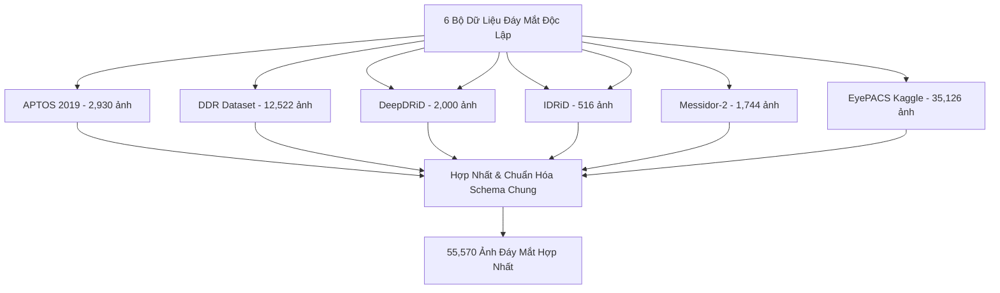

# Báo Cáo Phân Tích Toàn Diện 6 Bộ Dữ Liệu Võng Mạc Tiểu Đường (Diabetic Retinopathy)

> **Mục tiêu nghiên cứu:** Đánh giá đặc tính miền dữ liệu, phân bố nhãn, mất cân bằng lớp và nguy cơ rò rỉ dữ liệu (Data Leakage) cấp độ bệnh nhân trên 6 bộ dữ liệu chuẩn quốc tế.  
> **Mã nguồn liên quan:** [`data_loader.py`](file:///d:/Github/deep-learning-for-computer-vision/notebooks/diabetic_retinopathy/pipeline/full/data_loader.py), [`eda_6_datasets.ipynb`](file:///d:/Github/deep-learning-for-computer-vision/notebooks/diabetic_retinopathy/pipeline/eda/eda_6_datasets.ipynb).

---

## 1. Tổng Quan 6 Bộ Dữ Liệu Nghiên Cứu

Hệ thống tích hợp và chuẩn hóa 6 bộ dữ liệu ảnh đáy mắt (Color Fundus Photography) phổ biến nhất trong nghiên cứu chẩn đoán Bệnh võng mạc tiểu đường:



### 1.1. Bảng Tổng Hợp Thông Số Kỹ Thuật 6 Bộ Dữ Liệu

| Tên Dataset | Nguồn gốc / Đơn vị thu thập | Thiết bị Camera chụp | Độ phân giải gốc (px) | Số lượng ảnh | Số bệnh nhân định danh | Định dạng file |
| :--- | :--- | :--- | :--- | :--- | :--- | :--- |
| **APTOS 2019** | Aravind Eye Hospital (Ấn Độ) | Đa dạng máy chụp đáy mắt kỹ thuật số | $1886 \times 1458$ (Biến thiên) | 3,662 | 3,662 (Bệnh nhân ẩn danh) | `.png` |
| **DDR** | Đa bệnh viện đối tác (Trung Quốc) | Đa dạng thiết bị lâm sàng | $816 \times 734$ ($1.05\text{x}$) | 12,522 | 12,522 (Ảnh đã tiền xử lý ROI) | `.jpg` |
| **DeepDRiD** | Thử thách ISBI 2020 (Trung Quốc) | Topcon TRC-NW400 (Chụp đa góc 2 mắt) | $1820 \times 1872$ | 2,000 | 500 (4 ảnh/bệnh nhân: 2 mắt, 2 góc) | `.jpg` |
| **IDRiD** | Bệnh viện Mắt Nanded (Ấn Độ) | Kowa VX-10 $\alpha$ ($50^\circ$ FOV) | $4288 \times 2848$ (Cực cao) | 516 | 516 (Gộp Train + Test) | `.jpg` |
| **Messidor-2** | Bệnh viện ĐH Brest & Saint-Étienne (Pháp) | Topcon TRC NW6 ($45^\circ$ FOV) | $512 \times 512$ ($1.00\text{x}$) | 1,744 | 1,744 (Chụp 2 mắt mỗi bệnh nhân) | `.jpg` |
| **EyePACS** | Kaggle Challenge (EyePACS, Mỹ) | Đa dạng camera lâm sàng toàn cầu | $3651 \times 2490$ ($1.46\text{x}$) | 35,126 | 35,126 (Chụp cặp 2 mắt Trái/Phải) | `.jpeg` |
| **TỔNG CỘNG** | **Đa trung tâm toàn cầu** | **Hơn 8 dòng thiết bị quang học** | **$512 \to 4288$ px** | **55,570** | **53,970 bệnh nhân duy nhất** | - |

---

## 2. Tiêu Chuẩn Thang Đo Quốc Tế ICDRS (0–4)

Toàn bộ nhãn của 6 bộ dữ liệu được ánh xạ thống nhất về thang phân độ lâm sàng quốc tế **ICDRS (International Clinical Diabetic Retinopathy Severity Scale)**:

```
[Mức 0: No DR] ────────► Không có tổn thương nhìn thấy được
      │
[Mức 1: Mild] ─────────► CHỈ xuất hiện Vi phình mạch (Microaneurysms - MA)
      │
[Mức 2: Moderate] ─────► Xuất huyết (Hemorrhages), Xuất tiết cứng (Hard Exudates), Bông võng mạc (Cotton Wool Spots)
      │
[Mức 3: Severe] ───────► Quy tắc 4-2-1: Xuất huyết nặng ở 4 góc phần tư, Chuỗi hạt tĩnh mạch ở 2 góc, hoặc IRMA ở 1 góc
      │
[Mức 4: Proliferative] ─► Tăng sinh mạch máu mới (Neovascularization), Xuất huyết dịch kính / võng mạc lan rộng
```

### Chi Tiết Lâm Sàng Từng Giai Đoạn:
1. **Grade 0 (No DR - Bình thường):** Không phát hiện tổn thương võng mạc do đái tháo đường.
2. **Grade 1 (Mild Non-Proliferative DR - Nhẹ):** **Chỉ có vi phình mạch (Microaneurysms)**. Đây là những chấm đỏ siêu nhỏ ($10 - 50\,\mu\text{m}$), cực kỳ dễ bị biến mất nếu thuật toán thu nhỏ ảnh (downsampling) hoặc áp dụng bộ lọc làm mờ (Gaussian Blur).
3. **Grade 2 (Moderate NPDR - Trung bình):** Nhiều hơn vi phình mạch nhưng chưa đạt tiêu chuẩn của mức 3. Xuất hiện các đốm xuất huyết võng mạc, xuất tiết cứng lipid.
4. **Grade 3 (Severe NPDR - Nặng):** Tiền tăng sinh, tuân theo quy tắc chẩn đoán **4-2-1** nổi tiếng:
   * Xuất huyết nghiêm trọng ở cả 4 góc phần tư võng mạc.
   * Biến dạng chuỗi hạt tĩnh mạch (Venous beading) ở ít nhất 2 góc phần tư.
   * Bất thường vi mạch trong võng mạc (IRMA) ở ít nhất 1 góc phần tư.
   * *Đặc trưng AI:* Cần nắm bắt ngữ cảnh toàn cục (Global Context) trên toàn bộ bán cầu mắt để đếm và định vị tổn thương trên diện rộng.
5. **Grade 4 (Proliferative DR - Tăng sinh):** Giai đoạn nguy hiểm nhất với sự phát triển của các tân mạch máu bất thường, dễ vỡ gây xuất huyết tiền võng mạc, bong võng mạc và mù lòa vĩnh viễn.

---

## 3. Phân Tích Phân Bố Lớp & Mất Cân Bằng Dữ Liệu Nghiêm Trọng

### 3.1. Bảng Số Liệu Chi Tiết Theo Từng Bộ Dữ Liệu

| Dataset | Tổng ảnh | Grade 0 (No DR) | Grade 1 (Mild) | Grade 2 (Moderate) | Grade 3 (Severe) | Grade 4 (Proliferative) | Tỷ lệ Referable DR (Grade $\ge 2$) |
| :--- | :--- | :--- | :--- | :--- | :--- | :--- | :--- |
| **APTOS 2019** | 3,662 | 1,805 (49.3%) | 370 (10.1%) | 999 (27.3%) | 193 (5.3%) | 295 (8.1%) | 40.7% |
| **DDR** | 12,522 | 6,266 (50.0%) | 630 (5.0%) | 4,477 (35.8%) | 236 (1.9%) | 913 (7.3%) | 45.0% |
| **DeepDRiD** | 2,000 | 680 (34.0%) | 356 (17.8%) | 392 (19.6%) | 392 (19.6%) | 180 (9.0%) | 48.2% |
| **IDRiD** | 516 | 168 (32.6%) | 25 (4.8%) | 168 (32.6%) | 93 (18.0%) | 62 (12.0%) | 62.6% |
| **Messidor-2** | 1,744 | 1,017 (58.3%) | 270 (15.5%) | 347 (19.9%) | 75 (4.3%) | 35 (2.0%) | 26.2% |
| **EyePACS** | 35,126 | 25,810 (73.5%) | 2,443 (7.0%) | 5,292 (15.1%) | 873 (2.5%) | 708 (2.0%) | 19.6% |
| **HỢP NHẤT** | **55,570** | **35,746 (64.3%)** | **4,094 (7.4%)** | **11,675 (21.0%)** | **1,862 (3.4%)** | **2,193 (3.9%)** | **28.3%** |

### 3.2. Nhận Xét Về Mất Cân Bằng & Điểm Yếu Của Mô Hình

```
Phân Bố Hợp Nhất 55,570 Ảnh:
[Grade 0: 64.3%] ████████████████████████████████████████████████████████
[Grade 1:  7.4%] ███████
[Grade 2: 21.0%] ████████████████████
[Grade 3:  3.4%] ████
[Grade 4:  3.9%] ████
```

1. **Sự thống trị của Grade 0:** Chiếm tới **65.2%** toàn bộ tập dữ liệu (đặc biệt trong EyePACS chiếm 73.5%). Nếu huấn luyện không có chiến lược cân bằng (Class Balancing / Weighted Loss), mô hình sẽ có xu hướng tối ưu hóa bằng cách dự đoán đa số là Grade 0, khiến độ nhạy (Sensitivity) trên các ca bệnh nguy cấp sụt giảm nghiêm trọng.
2. **"Tử huyệt" Grade 1 (Mild DR - 7.0%):** Grade 1 có tỷ lệ mẫu rất thấp và biểu hiện bệnh lý duy nhất là vi phình mạch siêu nhỏ. Khi mô hình bị mất thông tin độ phân giải cao hoặc bị làm mờ, Grade 1 gần như luôn bị mô hình nhầm lẫn thành Grade 0 (âm tính giả cực kỳ nguy hiểm).
3. **"Tử huyệt" Grade 3 (Severe NPDR - 3.5%):** Là giai đoạn có số lượng mẫu ít nhất trong toàn bộ tập dữ liệu (chỉ 1,865 ảnh trên gần 54,000 ảnh). Do không có tân mạch máu rõ rệt như Grade 4 nhưng tổn thương lại lan rộng hơn Grade 2, mô hình thường xuyên phân loại nhầm Grade 3 thành Grade 2 hoặc Grade 4 nếu thiếu khả năng đánh giá ngữ cảnh toàn cục (Global Context).

---

## 4. Nguy Cơ Rò Rỉ Dữ Liệu Cấp Độ Bệnh Nhân (Patient-Level Data Leakage)

### 4.1. Bản Chất Của Vấn Đề

Trong nhãn khoa thực tế, một bệnh nhân thường được chụp cả **mắt trái (Left Eye)** và **mắt phải (Right Eye)** (hoặc chụp nhiều góc độ trên cùng một mắt như trong DeepDRiD). Hai mắt của cùng một người có chung:
* Đặc điểm sắc tố biểu mô võng mạc (Retinal pigment epithelium).
* Kiểu phân nhánh của cây mạch máu gốc (Vascular geometry & bifurcation patterns).
* Độ mờ quang học môi trường trong suốt của mắt (Đục thủy tinh thể, khúc xạ giác mạc).
* Mức độ tổn thương toàn thân do bệnh đái tháo đường gây ra.

```
❌ PHÂN CHIA SAI (Stratified Random Split):
Bệnh nhân A ───┬──► Mắt Trái (Left)  ──► Nằm trong tập TRAIN (Model học thuộc mạch máu)
               └──► Mắt Phải (Right) ──► Nằm trong tập TEST  (Model nhận ra mạch máu quen -> QWK cao ảo)

✅ PHÂN CHIA ĐÚNG (Patient-Level GroupKFold):
Bệnh nhân A ───┬──► Mắt Trái (Left)  ──► TOÀN BỘ NẰM TRONG TẬP TRAIN
               └──► Mắt Phải (Right) ─┘  (Hoặc TOÀN BỘ NẰM TRONG TẬP TEST)
               ===> ZERO PATIENT OVERLAP (Không có sự giao thoa bệnh nhân)
```

### 4.2. Giải Pháp Triệt Để Trong Pipeline (`data_loader.py`)

Module [`data_loader.py`](file:///d:/Github/deep-learning-for-computer-vision/notebooks/diabetic_retinopathy/pipeline/full/data_loader.py) cài đặt hàm chuẩn hóa trích xuất `patient_id` và `side` (Left/Right) từ định dạng tên file của từng dataset:

```python
def parse_patient_and_side(image_id: str, dataset_key: str) -> Tuple[str, str]:
    # Trích xuất Patient ID duy nhất và Mắt Trái/Phải
    # Đảm bảo gán tiền tố dataset_key để tránh trùng mã ID giữa các dataset khác nhau
    global_patient_id = f"{dataset_key}_{patient_id}"
    return global_patient_id, side
```

Khi chia tập huấn luyện và kiểm định, bắt buộc áp dụng `GroupShuffleSplit` hoặc `GroupKFold` theo `groups=df['patient_id']`, đồng thời kiểm tra assertion nghiêm ngặt:

```python
# Kiểm tra tuyệt đối không có sự giao thoa bệnh nhân
train_patients = set(train_df["patient_id"])
val_patients = set(val_df["patient_id"])
overlap = train_patients.intersection(val_patients)
assert len(overlap) == 0, f"[CRITICAL ERROR] Phát hiện Data Leakage! Số bệnh nhân trùng: {len(overlap)}"
```

---

## 5. Phân Tích Hiện Tượng Lệch Miền Dữ Liệu (Domain Shift)

Kết quả khảo sát EDA trên [`eda_6_datasets.ipynb`](file:///d:/Github/deep-learning-for-computer-vision/notebooks/diabetic_retinopathy/pipeline/eda/eda_6_datasets.ipynb) chỉ ra 3 nguyên nhân cốt lõi gây ra lệch miền nghiêm trọng giữa 6 bộ dữ liệu:

### 5.1. Lệch Miền Do Thiết Bị & Quang Học (Hardware & Optical Discrepancy)
* **IDRiD:** Sử dụng máy ảnh Kowa VX-10 $\alpha$ với trường nhìn $50^\circ$, ảnh có độ phân giải siêu cao ($4288 \times 2848$), độ sắc nét viền mạch máu cực lớn.
* **Messidor-2:** Sử dụng máy ảnh Topcon TRC NW6 với trường nhìn $45^\circ$, độ phân giải trung bình ($1440 \times 960$), độ tương phản tương đối dịu, nền võng mạc ngả cam đỏ đồng nhất.
* **EyePACS:** Thu thập từ hàng trăm phòng khám cơ sở khắp nước Mỹ với nhiều loại camera cầm tay và để bàn khác nhau. Ảnh có độ biến thiên chất lượng cực lớn (nhiều ảnh bị mờ do chuyển động - motion blur, lệch tiêu cự, hoặc sai lệch cân bằng trắng).
* **DDR:** Chụp từ các thiết bị tại Trung Quốc với viền quang học cắt tròn đặc thù, tỷ lệ viền đen chiếm tới 35-45% diện tích khung hình.

### 5.2. Khác Biệt Về Phân Bố Độ Sáng & Độ Tương Phản
* Phân tích histogram kênh xám (Grayscale Brightness) cho thấy giá trị trung bình trải dài từ $62.4 \pm 18.2$ (EyePACS - tối) đến $118.5 \pm 22.1$ (APTOS - sáng rõ).
* Độ sắc nét đo bằng phương sai bộ lọc Laplacian ($\text{Var}(\Delta I)$) dao động từ $150$ (ảnh mờ nhẹ trong EyePACS) lên tới hơn $2,400$ (ảnh cực nét trong IDRiD).

### 5.3. Hệ Quả Đối Với Mô Hình AI
Nếu một mô hình được huấn luyện trên một miền dữ liệu cố định (ví dụ chỉ train trên EyePACS), mô hình sẽ học các đặc trưng nhân tạo (artifacts) của thiết bị chụp đó (như sắc thái màu nền hoặc viền quang học) thay vì học bản chất tổn thương vi mạch. Khi triển khai sang IDRiD hoặc Messidor-2, hiệu năng QWK sẽ bị sụp đổ hoàn toàn (**OOD Performance Collapse**).

---

## 6. Cấu Hình Dataset Loader Chuẩn Hóa (`DATASET_CONFIG`)

Hệ thống quản lý dữ liệu tập trung qua từ điển cấu hình chuẩn trong [`data_loader.py`](file:///d:/Github/deep-learning-for-computer-vision/notebooks/diabetic_retinopathy/pipeline/full/data_loader.py):

```python
DATASET_CONFIG = {
    "APTOS": {
        "name": "APTOS 2019",
        "csv_path": "aptos/train_1.csv",
        "img_dir": "aptos/train_images/train_images",
        "id_col": "id_code",
        "label_col": "diagnosis",
        "id_suffix": ".png",
        "nested_patient": False
    },
    "DDR": {
        "name": "DDR Dataset",
        "csv_path": "ddr/DR_grading.csv",
        "img_dir": "ddr/DR_grading/DR_grading",
        "id_col": "id_code",
        "label_col": "diagnosis",
        "id_suffix": "",
        "nested_patient": False
    },
    "DeepDRiD": {
        "name": "DeepDRiD",
        "csv_path": "deepdrid/.../regular-fundus-training.csv",
        "img_dir": "deepdrid/.../Images",
        "id_col": "image_id",
        "label_col": "patient_DR_Level",
        "id_suffix": ".jpg",
        "nested_patient": True  # Chứa thư mục con theo Patient ID
    },
    "IDRiD": {
        "name": "IDRiD",
        "csv_path": "idrid/idrid_labels.csv",
        "img_dir": "idrid/Imagenes/Imagenes",
        "id_col": "id_code",
        "label_col": "diagnosis",
        "id_suffix": ".jpg",
        "nested_patient": False
    },
    "Messidor-2": {
        "name": "Messidor-2",
        "csv_path": "messidor2preprocess/messidor_data.csv",
        "img_dir": "messidor2preprocess/messidor-2/messidor-2/preprocess",
        "id_col": "id_code",
        "label_col": "diagnosis",
        "id_suffix": "",
        "nested_patient": False
    },
    "EyePACS": {
        "name": "EyePACS (Kaggle)",
        "csv_path": "zipEyepacs/trainLabels.csv/trainLabels.csv",
        "img_dir": "zipEyepacs/train",
        "id_col": "image",
        "label_col": "level",
        "id_suffix": ".jpeg",
        "nested_patient": False
    }
}
```
