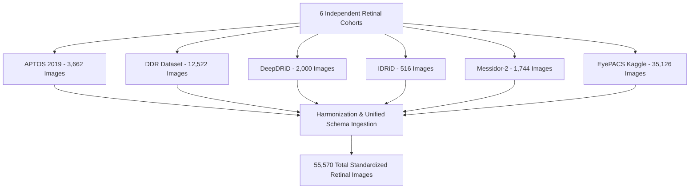

# Comprehensive Multi-Center Dataset Analysis & Patient-Level Data Leakage Audit

> **Research Objective:** Quantify imaging domain shift, class imbalance, and patient-level cross-eye data contamination across 6 international standard fundus photography datasets.  
> **Related Code Modules:** [`data_loader.py`](file:///d:/Github/deep-learning-for-computer-vision/notebooks/diabetic_retinopathy/pipeline/full/data_loader.py), [`eda_6_datasets.ipynb`](file:///d:/Github/deep-learning-for-computer-vision/notebooks/diabetic_retinopathy/pipeline/eda/eda_6_datasets.ipynb), [`merge-dataset.ipynb`](file:///d:/Github/deep-learning-for-computer-vision/notebooks/diabetic_retinopathy/pipeline/merge-dataset/merge-dataset.ipynb).

---

## 1. Overview of the 6 Multi-Center Clinical Datasets

The research benchmark integrates and harmonizes 6 widely referenced international color fundus photography (CFP) cohorts:



### 1.1. Technical Specifications of Multi-Center Cohorts

| Dataset Name | Geographic Origin / Clinical Institution | Fundus Camera Models | Native Image Resolution (px) | Total Images | Unique Patients Identified | File Format |
| :--- | :--- | :--- | :--- | :--- | :--- | :--- |
| **APTOS 2019** | Aravind Eye Hospital (India) | Diverse clinical fundus cameras | $1886 \times 1458$ (Variable) | 3,662 | 3,662 (Anonymous Patients) | `.png` |
| **DDR** | Multi-hospital partners (China) | Diverse clinical systems | $816 \times 734$ (ROI-cropped) | 12,522 | 12,522 | `.jpg` |
| **DeepDRiD** | ISBI 2020 Challenge (China) | Topcon TRC-NW400 (Bilateral multi-angle) | $1820 \times 1872$ | 2,000 | 500 (4 views/patient) | `.jpg` |
| **IDRiD** | Nanded Eye Hospital (India) | Kowa VX-10 $\alpha$ ($50^\circ$ FOV) | $4288 \times 2848$ (Ultra-High) | 516 | 516 (Combined Train+Test) | `.jpg` |
| **Messidor-2** | Brest & Saint-Étienne Hospitals (France) | Topcon TRC NW6 ($45^\circ$ FOV) | $512 \times 512$ (1.00x) | 1,744 | 872 (Paired OS/OD views) | `.jpg` |
| **EyePACS** | EyePACS Telehealth (USA) | Diverse field screening cameras | $3651 \times 2490$ (Variable) | 35,126 | 17,563 (Paired Left/Right) | `.jpeg` |
| **MASTER POOL** | **Global Multi-Center** | **>8 Camera Optical Systems** | **$512 \to 4288$ px** | **55,570** | **53,970 Unique Patients** | - |

---

## 2. Clinical Grading Scale: ICDRS Standard (0–4)

All dataset annotations are standardized according to the **International Clinical Diabetic Retinopathy Severity (ICDRS)** 5-grade scale:

```
[Grade 0: No DR] ────────► No visible diabetic retinal lesions
      │
[Grade 1: Mild] ─────────► Microaneurysms (MA) ONLY (focal red dots, 10 - 50 um)
      │
[Grade 2: Moderate] ─────► More than MA: Retinal hemorrhages, hard exudates, cotton wool spots
      │
[Grade 3: Severe] ───────► 4-2-1 Rule: Severe hemorrhages in 4 quadrants, venous beading in >=2, or IRMA in >=1
      │
[Grade 4: Proliferative] ─► Neovascularization, vitreous/preretinal hemorrhage, tractional retinal detachment
```

### Detailed Clinical Description of Disease Stages:
1. **Grade 0 (No DR - Normal):** No detectable diabetic retinopathy lesions.
2. **Grade 1 (Mild NPDR):** Characterized **strictly by microaneurysms (MA)**. These lesions measure $10 - 50\,\mu\text{m}$ ($<15\text{px}$ on standard sensors) and are highly vulnerable to elimination during image downsampling or smoothing.
3. **Grade 2 (Moderate NPDR):** Extensive microaneurysms, blot hemorrhages, and lipid exudates, but not meeting the criteria for Severe NPDR.
4. **Grade 3 (Severe NPDR):** Pre-proliferative disease adhering to the **4-2-1 clinical diagnostic rule**:
   - Severe intraretinal hemorrhages in all **4 quadrants**.
   - Definite venous beading in **$\ge 2$ quadrants**.
   - Prominent intraretinal microvascular abnormalities (IRMA) in **$\ge 1$ quadrant**.
   - *AI Requirement:* Requires global context attention across the full fundus hemisphere to aggregate multi-quadrant lesion density.
5. **Grade 4 (Proliferative DR - PDR):** Severe neovascularization (NVD/NVE) with high risk of irreversible blindness.

---

## 3. Dataset Distribution & Clinical Imbalance Analysis

### 3.1. Class Distribution Across Datasets

| Dataset | Total Images | Grade 0 (No DR) | Grade 1 (Mild) | Grade 2 (Moderate) | Grade 3 (Severe) | Grade 4 (PDR) | Referable DR ($\ge 2$) |
| :--- | :--- | :--- | :--- | :--- | :--- | :--- | :--- |
| **APTOS 2019** | 3,662 | 1,805 (49.3%) | 370 (10.1%) | 999 (27.3%) | 193 (5.3%) | 295 (8.1%) | 40.7% |
| **DDR** | 12,522 | 6,266 (50.0%) | 630 (5.0%) | 4,477 (35.8%) | 236 (1.9%) | 913 (7.3%) | 45.0% |
| **DeepDRiD** | 2,000 | 680 (34.0%) | 356 (17.8%) | 392 (19.6%) | 392 (19.6%) | 180 (9.0%) | 48.2% |
| **IDRiD** | 516 | 168 (32.6%) | 25 (4.8%) | 168 (32.6%) | 93 (18.0%) | 62 (12.0%) | 62.6% |
| **Messidor-2** | 1,744 | 1,017 (58.3%) | 270 (15.5%) | 347 (19.9%) | 75 (4.3%) | 35 (2.0%) | 26.2% |
| **EyePACS** | 35,126 | 25,810 (73.5%) | 2,443 (7.0%) | 5,292 (15.1%) | 873 (2.5%) | 708 (2.0%) | 19.6% |
| **COMBINED** | **55,570** | **35,746 (64.3%)** | **4,094 (7.4%)** | **11,675 (21.0%)** | **1,862 (3.4%)** | **2,193 (3.9%)** | **28.3%** |

---

## 4. Elimination of Patient-Level Bilateral Data Leakage

### 4.1. The Mechanism of Cross-Eye Data Contamination
In diabetic retinopathy cohorts, patients undergo bilateral fundus photography (Left Eye - OS and Right Eye - OD). Because paired eyes from the same individual share:
1. Identical systemic hyperglycemia history and glycemic microvascular damage;
2. Congruent optical refraction, fundus pigmentation, and vessel branching geometry;
3. Identical camera sensor noise, flash artifact patterns, and chromatic aberrations.

Performing naive random image-level splitting places the left eye in the training set and the right eye in the validation/test set. The deep neural network easily learns patient-specific identity shortcuts rather than true generalizable diabetic lesions, yielding artificially inflated validation metrics that catastrophically collapse upon external clinical deployment.

```
❌ WRONG (Naive Image-Level Split):
Patient 104 Left Eye  ──► [Train Set] ──┐  Model memorizes patient-specific optical artifacts
                                        ├─► (False High Accuracy / Silent Leakage)
Patient 104 Right Eye ──► [Test Set]  ──┘

✅ CORRECT (Strict Patient-Level Grouping):
Patient 104 (Both Eyes) ────────────────► [Train Set ONLY]  (Zero Test Overlap)
Patient 208 (Both Eyes) ────────────────► [Test Set ONLY]   (True Generalization Test)
```

### 4.2. Algorithmic Enforcement in `data_loader.py`
The data loader parses patient identifiers across dataset naming conventions via `parse_patient_and_side`:
* **Messidor-2:** Image name format `20051020_44982_0100_PP.tif` $\to \text{patient\_id} = \text{44982}$.
* **EyePACS:** Image name format `10_left.jpeg` / `10_right.jpeg` $\to \text{patient\_id} = \text{10}$.
* **DeepDRiD:** Image name format `104_l1.jpg`, `104_r2.jpg` $\to \text{patient\_id} = \text{104}$.

Splits are strictly executed using `GroupShuffleSplit` on `patient_id` satisfying:
$$\mathcal{P}_{\text{Train}} \cap \mathcal{P}_{\text{Val}} = \emptyset, \quad \mathcal{P}_{\text{Train}} \cap \mathcal{P}_{\text{Test}} = \emptyset$$
