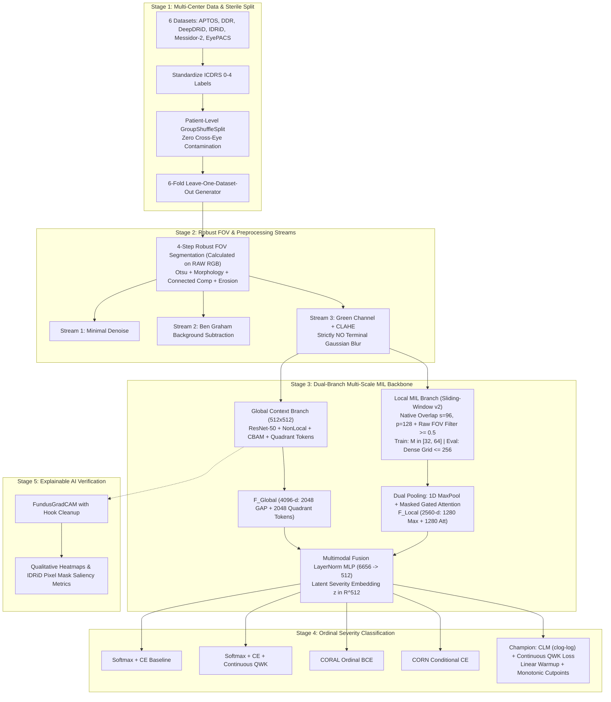

# End-to-End Pipeline Architecture: Multi-Scale Ordinal Multiple Instance Learning

> **Research Goal:** Construct an integrated, multi-scale deep learning framework combining Multiple Instance Learning (MIL) and Ordinal Regression (Cumulative Link Models) to resolve imaging domain shift and downsampling pixel-loss in diabetic retinopathy grading.  
> **Related Code Modules:** 
> - *Python Modules:* [`data_loader.py`](file:///d:/Github/deep-learning-for-computer-vision/notebooks/diabetic_retinopathy/pipeline/full/data_loader.py), [`preprocessing.py`](file:///d:/Github/deep-learning-for-computer-vision/notebooks/diabetic_retinopathy/pipeline/full/preprocessing.py), [`models.py`](file:///d:/Github/deep-learning-for-computer-vision/notebooks/diabetic_retinopathy/pipeline/full/models.py), [`losses_and_heads.py`](file:///d:/Github/deep-learning-for-computer-vision/notebooks/diabetic_retinopathy/pipeline/full/losses_and_heads.py), [`trainer.py`](file:///d:/Github/deep-learning-for-computer-vision/notebooks/diabetic_retinopathy/pipeline/full/trainer.py), [`visualization.py`](file:///d:/Github/deep-learning-for-computer-vision/notebooks/diabetic_retinopathy/pipeline/full/visualization.py).
> - *Experimental Notebooks:* [`main_model (6).ipynb`](file:///d:/Github/deep-learning-for-computer-vision/notebooks/diabetic_retinopathy/pipeline/model/main_model%20(6).ipynb), [`main_model_head_ablation (3).ipynb`](file:///d:/Github/deep-learning-for-computer-vision/notebooks/diabetic_retinopathy/pipeline/model/main_model_head_ablation%20(3).ipynb), [`main_model_lodo.ipynb`](file:///d:/Github/deep-learning-for-computer-vision/notebooks/diabetic_retinopathy/pipeline/model/main_model_lodo.ipynb), [`main_model.ipynb`](file:///d:/Github/deep-learning-for-computer-vision/notebooks/diabetic_retinopathy/pipeline/model/main_model.ipynb), [`main_model_preprocessing_ablation.ipynb`](file:///d:/Github/deep-learning-for-computer-vision/notebooks/diabetic_retinopathy/pipeline/model/main_model_preprocessing_ablation.ipynb), [`merge-dataset.ipynb`](file:///d:/Github/deep-learning-for-computer-vision/notebooks/diabetic_retinopathy/pipeline/merge-dataset/merge-dataset.ipynb).

---

## 1. End-to-End System Architecture



---

## 2. Stage 1: Data Ingestion & Multi-Center Sterile Split

### 2.1. Unified Schema Harmonization
All 6 cohorts are parsed through `data_loader.py` into a standardized master metadata format:
`['image_id', 'diagnosis', 'dataset_name', 'dataset_key', 'image_file', 'raw_full_path', 'patient_id', 'side']`.
Namespacing with `f"{dataset_key}::{patient_id}"` ensures zero cross-dataset identifier collisions.

### 2.2. Two-Tier Storage & Sterile Partitioning
1. **Tier 1 (Harmonized Native Images):** Standardized images cropped to the retinal ROI are saved once under `hybrid/native_cropped/{dataset_key}/{image_id}.jpg` at JPEG quality 95.
2. **Tier 2 (Splitting Before Balancing):** The master dataset is partitioned into 70% Train, 15% Validation, and 15% Test using patient-level grouping (`GroupShuffleSplit`). Multi-source quota balancing is applied **strictly to the training pool** (`train_metadata.csv`), ensuring that Validation (`val_metadata.csv`) and Test (`test_metadata.csv`) sets preserve their natural clinical prevalence.

### 2.3. High-Throughput DataLoader & IPC Optimization
* **Zero OpenCV Worker Thrashing:** Explicitly invoke `cv2.setNumThreads(0)` to prevent PyTorch DataLoader multi-workers from spawning independent thread pools that overload host CPU cores.
* **Low-Overhead Shared Memory IPC (`uint8` Transmission):** DataLoader workers transmit raw `uint8` tensors (reducing IPC memory bandwidth from $755\text{ MB}$ to $189\text{ MB}$ per batch, a $4\times$ saving). ImageNet Z-score normalization (`div(255).sub(mean).div(std)`) is executed directly on GPU Tensor Cores inside the training engine.
* **Deterministic Evaluation Collate:** Validation and Test loaders strictly employ `eval_collate_fn` to ensure zero stochastic patch sampling noise during model checkpoint selection.

### 2.4. Offline Precomputed Coordinate & Preprocessing Caching Engine
To eliminate massive redundant CPU cycles during multi-epoch training, the pipeline integrates a 2-tier offline coordinate caching architecture:

* **Bottleneck Profiling Without Caching:**
  * Bilateral filtering (`d=9, sigma=75`): $187\text{ ms}$
  * Gaussian background subtraction ($\sigma=30$): $354\text{ ms}$
  * 4-step FOV mask computation (Otsu + Morphological filtering): $242\text{ ms}$
  * Strided candidate grid scanning: $23\text{ ms}$
  * **Total latency per image:** $\approx 810\text{ ms}$ on host CPU.
  * **Epoch Cost:** $7,000\text{ images} \times 810\text{ ms} \times 100\text{ epochs} \approx 158\text{ CPU hours}$ of purely deterministic, wasted re-computation.

* **Two-Tier Coordinate Pre-Caching Architecture:**
  * **Storage Format:** Compressed NumPy archive (`.npz`) stored under `cache/{dataset_key}/{image_id}.npz`.
  * **Payload Keys:**
    1. `img`: Preprocessed `uint8` array after Green channel ablation / Ben Graham background subtraction.
    2. `anchors`: $(N, 2)$ `int32` array containing the valid top-left patch anchor coordinates $[y_0, x_0]$ satisfying the FOV threshold ($\ge 0.5$).
  * **Disk Footprint Optimization:** Storing only 2D anchor coordinates instead of pre-sliced image patches avoids disk bloat ($\approx 50\text{--}100\text{ KB/sample}$ vs. $>50\text{ MB/sample}$ for 256 sliced pixel crops).
  * **High-Speed In-Memory Slicing:** During `__getitem__`, `.npz` loading takes $20\text{--}30\text{ ms}$. In `trainer_compatible_collate_fn`, slicing $M \in [32, 64]$ patches directly from loaded numpy arrays takes $<1\text{ ms}$ per sample, yielding an end-to-end DataLoader throughput acceleration of **$>25\times$** while maintaining stochastic sub-sampling for spatial regularization.

---

## 3. Stage 2: Robust FOV Segmentation & Preprocessing Streams

```
                                  [Raw Fundus Image]
                                          │
                     4-Step Robust Retinal FOV Segmentation (compute_fov_mask)
                     Strictly on RAW RGB (prevents Ben Graham 128-intensity collapse)
                     1. Otsu's Adaptive Thresholding (vs. Fixed 'gray > 15')
                     2. Morphological Close + Open (Ellipse 25x25)
                     3. Largest Connected Component Extraction (Removes watermarks/glare)
                     4. Inward Morphological Erosion (erode_px = 15)
                                          │
                      ┌───────────────────┼───────────────────┐
                      ▼                   ▼                   ▼
                  Stream 1            Stream 2            Stream 3 (Proposed)
              Minimal Baseline       Ben Graham           Green Channel CLAHE
             (Bilateral Denoise)   (Gaussian Sub)    (Strictly NO Terminal Blur)
```

### 3.1. 4-Step Robust FOV Segmentation (`compute_fov_mask`)
Replaces brittle static thresholding (`gray > 15`) with a 4-stage optical segmentation pipeline executed **strictly on the RAW RGB image**:
1. **Otsu's Adaptive Thresholding:** Dynamically calculates the optimal bimodal intensity separation per image on the raw fundus, preventing threshold collapse under non-standard sensor exposures. *(Critical: Computing Otsu on Ben Graham images maps the black background to gray 128, causing Otsu to fail and isolate only edge halos).*
2. **Morphological Close followed by Open:** Seals internal mask holes caused by dark vessel branches and bright reflective regions using a $25 \times 25$ elliptical structuring element, then removes isolated external noise.
3. **Largest Connected Component Extraction:** Strictly retains the primary circular retinal disk via `cv2.connectedComponentsWithStats`, eliminating calibration text, lens dust, and camera watermarks.
4. **Inward Morphological Erosion (`erode_px = 15`):** Strips away untrusted boundary vignetting and illumination halos at the camera perimeter.

### 3.2. Three Comparative Preprocessing Streams
1. **Stream 1 (Minimal Denoising):** Auto-crop ROI $\to$ Gentle bilateral filtering (`cv2.bilateralFilter(d=5, sigmaColor=30, sigmaSpace=30)`) $\to$ Resize.
2. **Stream 2 (Ben Graham Vasculature):** Auto-crop ROI $\to$ Local Gaussian background estimate $I_{\text{blur}}$ with $\sigma = W / 30$ $\to$ Subtraction:
   $$I_{\text{enhanced}} = 4 \cdot I - 4 \cdot I_{\text{blur}} + 128$$
3. **Stream 3 (Green Channel + CLAHE — Proposed):**
   * Extracts the **Green Channel** (maximal absorption contrast for hemoglobin at $\lambda \approx 540\text{nm}$).
   * Applies CLAHE (`clipLimit=2.0`, `tileGridSize=(8,8)`) directly to the Green Channel.
   * **Mandatory Rule:** Do NOT stack Ben Graham with CLAHE. **Strictly eliminate Gaussian smoothing** at the final stage to preserve focal microaneurysms ($\le 120\,\mu\text{m}$).

---

## 4. Stage 3: Dual-Branch Multi-Scale MIL Backbone

Module [`models.py`](file:///d:/Github/deep-learning-for-computer-vision/notebooks/diabetic_retinopathy/pipeline/full/models.py) and [`main_model.ipynb`](file:///d:/Github/deep-learning-for-computer-vision/notebooks/diabetic_retinopathy/pipeline/model/main_model.ipynb) implement two parallel, complementary streams:

```
                           [Native High-Resolution Fundus Image]
                                             │
                   ┌─────────────────────────┴─────────────────────────┐
                   ▼                                                   ▼
       [Global Context Branch (512x512)]           [Local Sliding-Window MIL Branch v2]
                   │                               - Patch Size: 128x128, Stride: s=96 px
               ResNet-50                           - Overlapping Scanning (25%) + Raw FOV Filter >= 0.5
                   │                               - Train: Random M in [32, 64] patches/epoch
           NonLocalBlock2D (H*W Relational)        - Eval: Dense Full Grid (up to 256 patches)
                   │                                                   │
             CBAM Attention                                     EfficientNet-B0
                   │                                                   │
        ┌──────────┴──────────┐                              Dual Aggregation Pooling:
        ▼                     ▼                              1. 1D Max-Pooling (Grade 1 MA, H1)
     Global GAP       QuadrantTokenAggregator                2. Masked Gated Attention (H2)
     (2048-d)         (4-Quadrant Transformer, 2048-d)                 │
        └──────────┬──────────┘                                F_Local (2560-d)
                   ▼                                                   │
           F_Global (4096-d)                                           │
                   │                                                   │
                   └─────────────────────────┬─────────────────────────┘
                                             ▼
                                [Multimodal Fusion (6656-d)]
                                             │
                                 LayerNorm Projection MLP
                                             │
                                 Latent Embedding (512-d)
                                             │
                         [Champion CLM_QWK Ordinal Regression Head]
```

### 4.1. Global Context Branch (ResNet-50 + Non-local + CBAM + Quadrant Tokens)
* **Input:** Full retinal view at $512 \times 512 \times 3$ (or $300 \times 300$).
* **Backbone:** ResNet-50 (ImageNet pretrained).
* **Attention & Relational Mechanisms:**
  1. **NonLocalBlock2D (Wang et al., 2018):** Full spatial self-attention over the $H \times W$ feature map after Layer 4 ($2048$ channels). Enables long-range spatial dependencies so lesions in one quadrant directly inform representations across distant quadrants.
  2. **CBAM Attention:** Sequential Channel Attention followed by $7 \times 7$ Spatial Attention:
     $$\mathbf{M}_c(F) = \sigma\Big(W_1\big(W_0(\text{AvgPool}(F))\big) + W_1\big(W_0(\text{MaxPool}(F))\big)\Big)$$
     $$\mathbf{M}_s(F') = \sigma\Big(f^{7\times 7}\big([\text{AvgPool}(F'); \text{MaxPool}(F')]\big)\Big)$$
  3. **QuadrantTokenAggregator:** Splits the feature map into the 4 clinical retinal quadrants (top-left, top-right, bottom-left, bottom-right). Pools each quadrant into a token and passes them through a 1-layer Transformer encoder with learned positional embeddings (`quadrant_pos_embed`). Explicitly verifies the **ICDR 4-2-1 clinical diagnostic rule for Grade 3 Severe NPDR ($H_2$)**:
     - Hemorrhages in all 4 quadrants
     - Venous beading in $\ge 2$ quadrants
     - Intraretinal Microvascular Abnormalities (IRMA) in $\ge 1$ quadrant
* **Output:** Concatenation of Global Average Pooling ($2048\text{-d}$) and Quadrant Token Summary ($2048\text{-d}$) $\to F_{\text{Global}} \in \mathbb{R}^{4096}$.

### 4.2. Local Multiple Instance Learning Branch (Sliding-Window v2 + EfficientNet-B0)
* **Sliding-Window Overlapping Extraction (`extract_mil_patches_sliding`):**
  * Replaces rigid non-overlapping partitioning with a dense sliding window: patch size $p = 128$, stride $s = 96\text{ px}$ (overlap ratio $25\%$).
  * **Adaptive Retinal FOV Filtering:** Slices patch mask from `compute_fov_mask` (computed on raw RGB) and enforces $\text{mean}(\text{mask}_{\text{patch}}) \ge 0.5$, discarding uninformative black background and corner patches without halo distortions.
  * **Dual Operational Modes:**
    1. *Training Mode:* Stochastically samples $M \in [32, 64]$ patches per epoch from valid FOV candidates (spatial regularization + bounded VRAM budget).
    2. *Evaluation Mode:* Performs a dense sweep across the entire candidate grid (up to $256$ patches), guaranteeing zero missed micro-lesions.
* **Per-Patch Feature Encoding:** EfficientNet-B0 applied per patch $\to$ Global Average Pooling $\to (B, N, 1280)$.
* **Dual Aggregation Pooling with Masked Gated Attention:**
  1. *1D Max-Pooling:* Captures extreme focal microaneurysms for **Grade 1 ($H_1$)**:
     $$F_{\text{Max}} = \max_{k \in \{1 \dots N\}} f_{\text{patch}}^{(k)}$$
  2. *Masked Gated Attention Pooling:* Learns attention weights $a_k$ while strictly ignoring padding tokens via boolean `patch_mask` [Batch, $N_{\max}$]:
     $$a_k = \frac{\exp(w^T (\tanh(V h_k) \odot \sigma(U h_k)) + \text{mask\_bias}_k)}{\sum_{j=1}^N \exp(w^T (\tanh(V h_j) \odot \sigma(U h_j)) + \text{mask\_bias}_j)}, \quad F_{\text{Att}} = \sum_{k=1}^N a_k h_k$$
     where $\text{mask\_bias}_k = 0$ if valid, and $-10^4$ if padding.
* **Output:** Concatenated feature vector $F_{\text{Local}} = [F_{\text{Max}} \,\|\, F_{\text{Att}}] \in \mathbb{R}^{2560}$.

### 4.3. Multimodal Fusion Layer
* Concatenation: $F_{\text{Fused}} = [F_{\text{Global}} \,\|\, F_{\text{Local}}] \in \mathbb{R}^{6656}$ ($4096 + 2560$).
* Nonlinear projection MLP (using `LayerNorm` for numerical stability across variable patch counts and small batch sizes):
  $$\text{Linear}(6656 \to 512) \to \text{LayerNorm} \to \text{Mish}() \to \text{Dropout}(0.3) \to \text{Linear}(512 \to 512) \to \text{LayerNorm}$$
* Output: Fused latent severity embedding $\mathbf{z} \in \mathbb{R}^{512}$.

---

## 5. Stage 4: Ordinal Classification & 5 Output Heads

### 5.1. Mathematical Formulation of the 5 Output Heads

| Head Configuration | Output Geometry | Loss Formulation | Clinical Ordinality |
| :--- | :--- | :--- | :--- |
| **1. Softmax_CE** | Categorical Logits via Linear(512, 5) | Standard Cross-Entropy | Non-ordinal (Rank violations observed) |
| **2. Softmax_QWK** | Categorical Logits via Linear(512, 5) | $\text{CE} + \lambda \cdot L_{\text{QWK}}$ | Quadratic distance penalty but unordered logits |
| **3. CORAL** | Consistent Rank Logits (Shared $w$, bias $b_k$) | Ordinal Binary CE | $P(y > k) = \sigma(w^T \mathbf{z} + b_k)$ (Violations if biases cross) |
| **4. CORN** | Conditional Ordinal NN | Conditional Binary CE | Cumulative product $P(y > k) = \prod_{j=0}^k P(y > j \mid y \ge j)$ |
| **5. CLM_QWK (Champion)** | Cumulative Link Model ($\text{clog-log}$) | Interval NLL $+ \lambda(t) L_{\text{QWK}}$ | **Optimal:** $0.0\%$ violations, asymmetric progression |

### 5.2. Mathematics of Champion CLM_QWK Head
* **Latent Severity Score:** Scalar linear projection $s(\mathbf{x}) = \mathbf{w}^T \mathbf{z}$.
* **Strictly Monotonic Cutpoints:** Parameterized via positive softplus increments:
  $$\theta_1 \in \mathbb{R}, \quad \theta_{k+1} = \theta_k + \text{softplus}(\alpha_k) + 10^{-4} \quad (k = 1, 2, 3)$$
* **Complementary Log-Log ($\text{clog-log}$) Link Function:**
  $$P(Y \le k) = F(\theta_k - s(\mathbf{x})) = 1 - \exp(-\exp(\theta_k - s(\mathbf{x})))$$
* **Exact Interval Probabilities (Non-Zero Gradient Propagation):**
  $$P(Y = 0) = P(Y \le 0), \quad P(Y = k) = P(Y \le k) - P(Y \le k-1) \quad (k=1..3), \quad P(Y = 4) = 1 - P(Y \le 3)$$
  Because $\theta_k$ are strictly monotonic, interval differences are strictly positive mathematically. Computed directly without redundant $\text{ReLU}$ clipping, ensuring unhindered gradient propagation across the entire parameter space.
* **Hybrid Objective with Dynamic Linear Epoch-Level Warmup:**
  $$\mathcal{L}_{\text{CLM\_QWK}} = \mathcal{L}_{\text{NLL}}(\mathbf{p}, \mathbf{y}, \mathbf{w}_{\text{class}}) + \lambda(t) \cdot \mathcal{L}_{\text{Continuous\_QWK}}(\mathbf{p}, \mathbf{y})$$
  where $\lambda(t) = \min\left(1.0, \frac{t}{T_{\text{warmup}}}\right) \cdot \lambda_{\text{target}}$ is dynamically scaled at each epoch, stabilizing soft confusion matrix variance across training mini-batches.

### 5.3. Post-Hoc Screening Threshold Calibration (HD_4 Part 1 & Part 3)
* **Decoupling Screening from Argmax:** In binary clinical triage (Referable DR: Grade $\ge 2$ vs. Non-Referable: Grade $0, 1$), taking the nominal multi-class $\text{argmax}$ implicitly operates at an arbitrary, sub-optimal threshold (frequently exhibiting high specificity $\approx 95\%$ but depressed sensitivity $\approx 64.8\%$).
* **Validation-Only Calibration Protocol:**
  1. The Receiver Operating Characteristic (ROC) curve is constructed strictly on **Validation set continuous probabilities** $P(Y \ge 2) = \sum_{k=2}^4 p_k$.
  2. Operating decision thresholds $\tau_s$ are identified to satisfy fixed clinical specificity targets: $95\%$, $90\%$, $85\%$, and $80\%$.
  3. Fixed thresholds $\tau_s$ are then frozen and evaluated on the **held-out Test set** without test-distribution leakage.
* **Clinical Contextualization (UK NSC Standard):** Enables evaluating whether the system satisfies the United Kingdom National Screening Committee criteria ($\text{Sensitivity} \ge 80\%$ at $\text{Specificity} \ge 95\%$) and establishes the true discriminative power (Ref-AUC $= 0.9063$).
* **Suite-Wide Integration:** This post-hoc threshold calibration protocol is strictly wired across both the proposed multi-scale dual-branch model (`main_model (6).ipynb`) and the 5-round output head ablation benchmark suite ([`main_model_head_ablation (3).ipynb`](file:///d:/Github/deep-learning-for-computer-vision/notebooks/diabetic_retinopathy/pipeline/model/main_model_head_ablation%20(3).ipynb)), exporting structured calibration benchmarks (`screening_calibration_summary.csv`) comparing all 5 heads.

### 5.4. Continuous QWK Loss Stabilization & Convergence Schedule (HD_4 Part 4)
* **Root Cause of Optimization Stagnation:** Soft confusion matrices computed on small mini-batches ($B=48$) produce high gradient variance. When the quadratic penalty weight $\lambda$ ramps up too rapidly, QWK gradients dominate cross-entropy early in training, causing catastrophic validation drops (e.g., Val QWK collapsing from $0.6138$ to $0.4725$ at epoch 15).
* **Stabilization Directives:**
  1. **Extended Linear Warmup:** Warmup duration extended from $5$ to $15$ epochs ($T_{\text{warmup}} = 15$) at the epoch level to allow the cross-entropy / NLL objective to construct stable feature manifolds before QWK enforcement.
  2. **Calibrated Penalty Weight:** Scaled target weight down from $\lambda = 1.2$ to $\lambda = 0.4$ (matching the optimal range $0.3 - 0.5$ recommended by Vargas et al. and advisor review).
  3. **Decoupled Dual Monitoring:** Synchronized both `EarlyStopping` and `ModelCheckpoint` (`_best.pth`) to monitor `Validation QWK` (with extended patience $15$ epochs), replacing premature termination triggered by validation loss plateaus. Concurrently, learning rate reduction (`ReduceLROnPlateau`) is decoupled to monitor the smoother `Validation Loss` signal with an independent counter (`patience_reduce_lr = 4`, `reduce_lr_factor = 0.5`, `min_lr = 1e-6`), preventing plateau stalling.

---

## 6. Stage 5: Explainable AI (XAI) Verification & Local MIL Saliency Overhaul (HD_4 Part 2, 5, 6)

```
                            [XAI Evaluation Pipeline Architecture]
                                              │
               IDRiDXAIEvalDataset with Dual-Crop FoV Alignment (HD_4 Part 2)
               Crop BOTH raw fundus and expert lesion mask with the exact same
               bounding box [y0:y1, x0:x1] from compute_fov_mask(img_np, erode_px=0)
                                              │
                    ┌─────────────────────────┴─────────────────────────┐
                    ▼                                                   ▼
        [Global Grad-CAM Stream]                           [Local Attention-MIL Stream]
        - ResNet-50 Layer 4 (2048-ch)                      - EfficientNet-B0 Instance Features
        - 16x16 Feature Grid (~268 px)                     - Gated Attention Weights alpha_k
        - Forward/Backward Hook Removal                    - Splatted via [y0, x0] on Canvas (~128 px)
                    │                                                   │
                    └─────────────────────────┬─────────────────────────┘
                                              ▼
                           [Overhauled XAI Evaluation Metric Suite]
                           1. Pointing Game Accuracy vs. Empirical Random Baseline (~1.5%)
                           2. Saliency Recall @ Area-Matched (Top-q% Heatmap Quantile)
                           3. Continuous Pixel-level AUROC (Threshold-Free Discrimination)
                           4. Informational Mean IoU (Theoretical Ceiling ~0.050 Documented)
```

### 6.1. Dual-Crop FoV Alignment on External Benchmarks (`IDRiDXAIEvalDataset`)
* **Elimination of Scale/Margin Shift:** Raw IDRiD images ($4288 \times 2848$) possess large black lateral borders, whereas models are trained on cropped retinal ROIs (`native_cropped`). Resizing uncropped images to $512 \times 512$ compresses the retinal disc by $\approx 33\%$, displacing Grad-CAM activations away from ground-truth lesion coordinates.
* **Synchronized Bounding Box Crop:** `compute_fov_mask(img_np, erode_px=0)` identifies the retinal bounding box $[y_0:y_1, x_0:x_1]$ on the raw fundus image. The **exact same bounding box** is applied to both the fundus photograph and its pixel-level binary lesion mask prior to interpolation, guaranteeing $100\%$ spatial registration with training distributions.

### 6.2. Architecture-Native Attention-MIL Saliency Generator (`generate_attention_mil_saliency_map`)
* **Spatial Resolution Bottleneck in Grad-CAM:** ResNet-50 Layer 4 produces a $16 \times 16$ feature map on $512 \times 512$ inputs ($32\text{ px}$ stride, projecting to $\approx 268\text{ px}$ on high-resolution fundus photographs). A single feature pixel spans up to $\approx 35$ discrete microaneurysms, preventing precise focal lesion verification.
* **Native High-Resolution Saliency Map:** The Local MIL Branch directly outputs instance attention weights $\alpha_k \in [0, 1]$ from `GatedAttentionPool`. By splatting $\alpha_k$ onto a $512 \times 512$ spatial canvas using patch anchor coordinates $[y_0, x_0]$ and normalizing by overlapping coverage counts, the engine produces fine-grained, architecture-native saliency maps with **$\approx 128\text{ px}$ effective resolution**.
* **Comparative Empirical Benchmark:** Evaluates Global Grad-CAM vs. Local Attention-MIL side-by-side on the IDRiD mask cohort, providing direct empirical evidence for Hypothesis $H_1$ (local branch captures focal micro-lesions).

### 6.3. Overhauled Quantitative Saliency Metric Suite
* **Pointing Game with Empirical Random Baseline:** Measures whether the peak saliency point $\arg\max(\text{CAM})$ falls within the ground-truth lesion mask. Crucially reported alongside the empirical random chance baseline:
  $$p_{\text{random}} = \frac{\sum \text{Mask}_{\text{GT}}}{H \cdot W} \approx 1.5\%$$
  Demonstrates that a Pointing Game accuracy of $11.11\%$ represents a **$>7.4\times$ improvement over random chance**, rather than an absolute low performance.
* **Saliency Recall @ Area-Matched:** Thresholds the continuous heatmap at the top-$q\%$ quantile, where $q = \text{Area}(\text{Mask}_{\text{GT}}) / (H \cdot W)$. Measures the fraction of true lesion pixels captured within an area equal to the ground-truth lesion footprint, eliminating the penalty of arbitrary fixed thresholds.
* **Pixel-level AUROC:** Measures the Area Under the ROC Curve treating the continuous saliency map as a pixel-wise detector against binary ground-truth lesion masks, completely independent of threshold selection.
* **Deprecation of Raw Mean IoU Failure Narrative:** Documents the mathematical ceiling of IoU on micro-lesions:
  $$\text{IoU}_{\max} = \frac{\text{Area}(\text{Mask})}{\text{Area}(\text{CAM})} \approx \frac{1.5\%}{30\%} \approx 0.050$$
  Clarifies that an observed IoU of $\approx 0.02 - 0.03$ represents $40\% - 60\%$ of the theoretical maximum, establishing valid academic framing for review.
