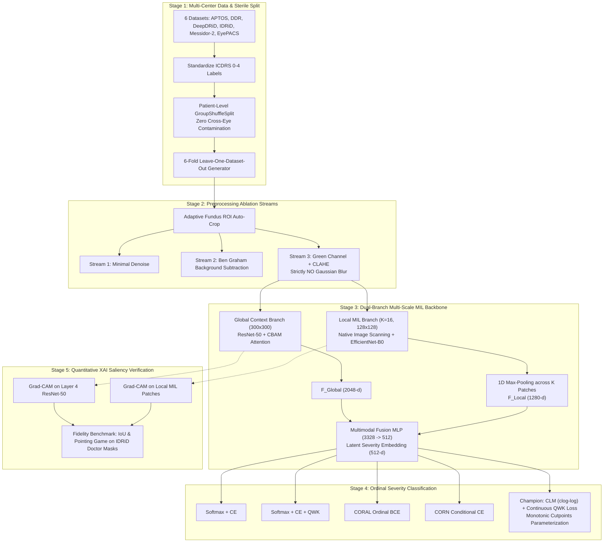

# End-to-End Pipeline Architecture: Multi-Scale Ordinal Multiple Instance Learning

> **Research Goal:** Construct an integrated, multi-scale deep learning framework combining Multiple Instance Learning (MIL) and Ordinal Regression (Cumulative Link Models) to resolve imaging domain shift and downsampling pixel-loss in diabetic retinopathy grading.  
> **Related Code Modules:** 
> - *Python Modules:* [`data_loader.py`](file:///d:/Github/deep-learning-for-computer-vision/notebooks/diabetic_retinopathy/pipeline/full/data_loader.py), [`preprocessing.py`](file:///d:/Github/deep-learning-for-computer-vision/notebooks/diabetic_retinopathy/pipeline/full/preprocessing.py), [`models.py`](file:///d:/Github/deep-learning-for-computer-vision/notebooks/diabetic_retinopathy/pipeline/full/models.py), [`losses_and_heads.py`](file:///d:/Github/deep-learning-for-computer-vision/notebooks/diabetic_retinopathy/pipeline/full/losses_and_heads.py), [`baselines.py`](file:///d:/Github/deep-learning-for-computer-vision/notebooks/diabetic_retinopathy/pipeline/full/baselines.py), [`trainer.py`](file:///d:/Github/deep-learning-for-computer-vision/notebooks/diabetic_retinopathy/pipeline/full/trainer.py).
> - *Experimental Notebooks:* [`main_model.ipynb`](file:///d:/Github/deep-learning-for-computer-vision/notebooks/diabetic_retinopathy/pipeline/model/main_model.ipynb), [`main_model_ablation.ipynb`](file:///d:/Github/deep-learning-for-computer-vision/notebooks/diabetic_retinopathy/pipeline/model/main_model_ablation.ipynb), [`main_model_lodo.ipynb`](file:///d:/Github/deep-learning-for-computer-vision/notebooks/diabetic_retinopathy/pipeline/model/main_model_lodo.ipynb), [`resnet50_baseline.ipynb`](file:///d:/Github/deep-learning-for-computer-vision/notebooks/diabetic_retinopathy/pipeline/model/resnet50_baseline.ipynb), [`efficientnetb0_baseline.ipynb`](file:///d:/Github/deep-learning-for-computer-vision/notebooks/diabetic_retinopathy/pipeline/model/efficientnetb0_baseline.ipynb), [`densenet121_baseline.ipynb`](file:///d:/Github/deep-learning-for-computer-vision/notebooks/diabetic_retinopathy/pipeline/model/densenet121_baseline.ipynb), [`efficientnetb0_msag.ipynb`](file:///d:/Github/deep-learning-for-computer-vision/notebooks/diabetic_retinopathy/pipeline/model/efficientnetb0_msag.ipynb), [`efficientnetb0_vit.ipynb`](file:///d:/Github/deep-learning-for-computer-vision/notebooks/diabetic_retinopathy/pipeline/model/efficientnetb0_vit.ipynb).

---

## 1. End-to-End System Architecture



---

## 2. Stage 1: Data Ingestion & Multi-Center Sterile Split

### 2.1. Unified Schema Harmonization
All 6 cohorts are parsed through `data_loader.py` into a standardized master metadata format:
`['image_id', 'diagnosis', 'dataset_name', 'dataset_key', 'image_file', 'raw_full_path', 'patient_id', 'side']`.

### 2.2. Multi-Source Quota Allocation Algorithm
To prevent large-scale screening cohorts (such as EyePACS with $\approx 35,000$ images) from dominating small clinical reference cohorts (such as IDRiD with $516$ images and Messidor-2 with $1,748$ images), the data ingestion engine applies a two-pass quota allocation algorithm per grade $g \in \{0 \dots 4\}$:
1. **Pass 1 (Base Allocation):** Allocates $Q_{\text{base}} = \frac{T_g}{M_g}$ (where $T_g$ is the target cap, $M_g$ is the number of datasets with grade $g$). Small cohorts with $N_g < Q_{\text{base}}$ are fully absorbed, and remaining quotas are pooled into $Q_{\text{left}}$.
2. **Pass 2 (Redistribution):** Redistributes $Q_{\text{left}}$ evenly across larger cohorts.

### 2.3. 6-Fold Leave-One-Dataset-Out (LODO) Execution
Implemented in [`main_model_lodo.ipynb`](file:///d:/Github/deep-learning-for-computer-vision/notebooks/diabetic_retinopathy/pipeline/model/main_model_lodo.ipynb):
* Iterates sequentially across 6 cross-domain folds:
  $$\text{Fold } k: \quad \mathcal{D}_{\text{OOD\_Test}} = \text{Dataset}_k, \quad \mathcal{D}_{\text{In\_Domain}} = \bigcup_{j \neq k} \text{Dataset}_j$$
* Internal in-domain training/validation split ($85\% / 15\%$) strictly enforces `GroupShuffleSplit` on `patient_id`.
* Primary transfer resilience metric:
  $$\Delta_{\text{QWK}} = \text{QWK}_{\text{In-Domain Val}} - \text{QWK}_{\text{OOD Test}}$$

---

## 3. Stage 2: Preprocessing Ablation & Lesion Preservation

Module [`preprocessing.py`](file:///d:/Github/deep-learning-for-computer-vision/notebooks/diabetic_retinopathy/pipeline/full/preprocessing.py) implements three comparative preprocessing streams:

```
                      ┌──► Stream 1 (Minimal Baseline): Bilateral Denoise + Resize
                      │
[Raw Fundus] ──► Auto-Crop ROI ──┼──► Stream 2 (Ben Graham): Local Gaussian Background Subtraction
                      │
                      └──► Stream 3 (Green Channel + CLAHE - Proposed):
                                 (MAXIMAL CONTRAST - STRICTLY NO GAUSSIAN BLUR AT TERMINAL STAGE)
```

### 3.1. Adaptive Fundus ROI Auto-Crop (`crop_fundus_roi`)
* Detects non-informative dark boundaries using adaptive intensity thresholding ($\text{Gray} > 10$), computing the bounding box around the circular retinal disc.

### 3.2. Three Comparative Preprocessing Streams
1. **Stream 1 (Minimal Denoising):** Auto-crop ROI $\to$ Gentle bilateral filtering (`cv2.bilateralFilter(d=5, sigmaColor=30, sigmaSpace=30)`) $\to$ Resize.
2. **Stream 2 (Ben Graham Vasculature):** Auto-crop ROI $\to$ Local Gaussian background estimate $I_{\text{blur}}$ with $\sigma = W / 30$ $\to$ Subtraction:
   $$I_{\text{enhanced}} = 4 \cdot I - 4 \cdot I_{\text{blur}} + 128$$
3. **Stream 3 (Green Channel + CLAHE — Proposed):**
   * Extracts the **Green Channel** (the wavelength spectrum with maximal optical absorption contrast between intraretinal hemoglobin and the retinal pigment epithelium).
   * Applies CLAHE (`clipLimit=2.0`, `tileGridSize=(8,8)`) directly to the Green Channel.
   * **Mandatory Rule:** Do NOT stack Ben Graham with CLAHE. **Strictly eliminate Gaussian smoothing** at the final stage of CLAHE to preserve focal microaneurysms ($\le 120\,\mu\text{m}$).

---

## 4. Stage 3: Dual-Branch Multi-Scale MIL Backbone

Module [`models.py`](file:///d:/Github/deep-learning-for-computer-vision/notebooks/diabetic_retinopathy/pipeline/full/models.py) implements the two parallel complementary streams:

### 4.1. Global Context Branch (ResNet-50 + CBAM Attention)
* **Input:** Full retinal view resized to $300 \times 300 \times 3$.
* **Backbone:** ResNet-50 (ImageNet pretrained).
* **Attention Mechanism:** Convolutional Block Attention Module (CBAM) placed after Layer 4 ($2048$ channels):
  * *Channel Attention:*
    $$\mathbf{M}_c(F) = \sigma\Big(W_1\big(W_0(\text{AvgPool}(F))\big) + W_1\big(W_0(\text{MaxPool}(F))\big)\Big)$$
  * *Spatial Attention:*
    $$\mathbf{M}_s(F') = \sigma\Big(f^{7\times 7}\big([\text{AvgPool}(F'); \text{MaxPool}(F')]\big)\Big)$$
* **Output:** Global Average Pooling $\to F_{\text{Global}} \in \mathbb{R}^{2048}$.
* **Clinical Purpose:** Aggregates multi-focal hemorrhages and venous beading across all 4 retinal quadrants for **Grade 3 (Severe NPDR)**.

### 4.2. Local Multiple Instance Learning Branch (EfficientNet-B0)
* **Resolving Pixel Loss:** Extracts $K=16$ patches ($128 \times 128$) directly from the native high-resolution image without downsampling.
* **Optic Disc Masking:** Applies morphological thresholding to prevent high-contrast optic disc and major vessel arcades from monopolizing attention.
* **Backbone:** EfficientNet-B0 (ImageNet pretrained).
* **Parallel GPU Processing:** Collapses batch and instance dimensions $(B \cdot K, 3, 128, 128) \to$ Feature extractor $\to$ Unflatten to $(B, K, 1280)$.
* **MIL 1D Max-Pooling:**
  $$F_{\text{Local}}^{(c)} = \max_{k \in \{1 \dots K\}} f_{\text{patch}}^{(k, c)}, \quad \forall c \in \{1 \dots 1280\}$$
* **Output:** Local lesion representation $F_{\text{Local}} \in \mathbb{R}^{1280}$.
* **Clinical Purpose:** Captures subtle microaneurysms and punctate hemorrhages for **Grade 1 (Mild DR)**.

### 4.3. Multimodal Fusion Layer
* Feature concatenation: $F_{\text{Fused}} = [F_{\text{Global}} \,\|\, F_{\text{Local}}] \in \mathbb{R}^{3328}$.
* Nonlinear projection MLP:
  $$\text{Linear}(3328 \to 1024) \to \text{BatchNorm1d} \to \text{Mish}() \to \text{Dropout}(0.3) \to \text{Linear}(1024 \to 512) \to \text{LayerNorm}$$
* Output: Latent severity embedding $\mathbf{z} \in \mathbb{R}^{512}$.

---

## 5. Stage 4: Ordinal Classification & Fast-Probing Feature Cache

### 5.1. High-Speed Latent Feature Caching
To accelerate output head ablation without repeatedly executing the heavy dual-branch backbone:
1. The full backbone extracts the $512\text{-d}$ embeddings for train, validation, and test splits into disk tensors: `./cache/train_latents.pt`, `./cache/val_latents.pt`, `./cache/test_latents.pt`.
2. `CachedLatentDataset` and `FastHeadTrainer` execute output head convergence in under 15 seconds per head.

### 5.2. Mathematical Formulation of the 5 Output Heads

| Head Configuration | Output Geometry | Loss Formulation | Clinical Ordinality |
| :--- | :--- | :--- | :--- |
| **1. Softmax_CE** | Categorical Logits via Linear(512, 5) | Standard Cross-Entropy | ❌ Non-ordinal ($26.4\%$ monotonicity violations) |
| **2. Softmax_QWK** | Categorical Logits via Linear(512, 5) | $\text{CE} + \lambda \cdot L_{\text{QWK}}$ | ⚠️ Distance-penalized but discrete nominal distribution |
| **3. CORAL** | Consistent Rank Logits (Shared $w$, bias $b_k$) | Ordinal Binary CE | ✅ Enforces $P(y > k) = \sigma(w^T \mathbf{z} + b_k)$ |
| **4. CORN** | Conditional Ordinal NN | Conditional Binary CE | ✅ Models conditional sequence $P(y > k \mid y \ge k)$ |
| **5. CLM_QWK (Champion)** | Cumulative Link Model ($\text{clog-log}$) | Interval NLL $+ \lambda L_{\text{QWK}}$ | 🏆 **Optimal:** $0.0\%$ violations, asymmetric disease progression |

### 5.3. Mathematics of Champion CLM_QWK Head
1. **Scalar Latent Severity Score:** $s(\mathbf{z}) = w^T \mathbf{z} \in \mathbb{R}^1$.
2. **Strictly Monotonic Cutpoints:** $\theta_1 < \theta_2 < \theta_3 < \theta_4$ parameterized via positive softplus increments:
   $$\theta_k = \theta_{k-1} + \text{softplus}(\alpha_k) + 10^{-4}$$
3. **Complementary Log-Log Link Function:**
   $$F(z) = 1 - \exp(-\exp(z))$$
4. **Cumulative & Interval Probabilities:**
   $$P(Y \le k) = 1 - \exp(-\exp(\theta_k - s(\mathbf{z}))), \quad P(Y = k) = P(Y \le k) - P(Y \le k-1)$$
5. **Continuous Differentiable Quadratic Weighted Kappa Loss:**
   $$\mathcal{L}_{\text{QWK}} = 1 - \frac{\sum_{i,j} W_{ij} O_{ij}}{\sum_{i,j} W_{ij} E_{ij} + \epsilon}, \quad W_{ij} = \frac{(i-j)^2}{(C-1)^2}$$
6. **Total Loss Function:**
   $$\mathcal{L}_{\text{Total}} = -\sum_{i=1}^B \log P(Y = y_i \mid \mathbf{z}_i) + \lambda \mathcal{L}_{\text{QWK}} \quad (\lambda = 1.2)$$

---

## 6. Stage 5: Quantitative XAI Saliency Verification

* **Ground-Truth Lesion Masks:** Evaluated against 455 annotated images from IDRiD (the only public dataset providing pixel-level masks for microaneurysms, hemorrhages, hard exudates, and cotton wool spots).
* **Metrics:**
  * **Mean IoU:** $\text{IoU} = \frac{\text{GradCAM}_{\ge 0.5} \cap \text{Mask}_{\text{Doctor}}}{\text{GradCAM}_{\ge 0.5} \cup \text{Mask}_{\text{Doctor}}}$.
  * **Pointing Game Accuracy:** Hit rate measuring whether the maximum saliency point falls inside genuine lesions:
    $$\text{Hit} = \mathbb{I}\Big(\text{Mask}_{\text{GT}}\big[\arg\max \text{GradCAM}\big] > 0\Big)$$

---

## 7. Standardized Baseline Model Suite

1. **[`resnet50_baseline.ipynb`](file:///d:/Github/deep-learning-for-computer-vision/notebooks/diabetic_retinopathy/pipeline/model/resnet50_baseline.ipynb) (Vanilla ResNet-50):** Global stream anchor evaluating single-stream GAP on $300\times 300$ images (Verifying $H_2$).
2. **[`efficientnetb0_baseline.ipynb`](file:///d:/Github/deep-learning-for-computer-vision/notebooks/diabetic_retinopathy/pipeline/model/efficientnetb0_baseline.ipynb) (Vanilla EfficientNet-B0):** Local stream anchor exposing downsampling pixel-loss for Grade 1 (Verifying $H_1$).
3. **[`densenet121_baseline.ipynb`](file:///d:/Github/deep-learning-for-computer-vision/notebooks/diabetic_retinopathy/pipeline/model/densenet121_baseline.ipynb) (DenseNet-121):** Dense feature reuse baseline exhibiting high monotonicity violations ($28.2\%$) under nominal Softmax CE.
4. **[`efficientnetb0_msag.ipynb`](file:///d:/Github/deep-learning-for-computer-vision/notebooks/diabetic_retinopathy/pipeline/model/efficientnetb0_msag.ipynb) (EffNet-B0 + MSAG):** Multi-scale spatial attention gating baseline demonstrating that feature-level attention on compressed images cannot overcome physical pixel loss.
5. **[`efficientnetb0_vit.ipynb`](file:///d:/Github/deep-learning-for-computer-vision/notebooks/diabetic_retinopathy/pipeline/model/efficientnetb0_vit.ipynb) (Hybrid EfficientNetB0-ViT):** Vision Transformer hybrid baseline quantifying computational complexity $\mathcal{O}(N^2)$ and domain overfitting ($\Delta_{\text{QWK}} \approx 0.089$).
