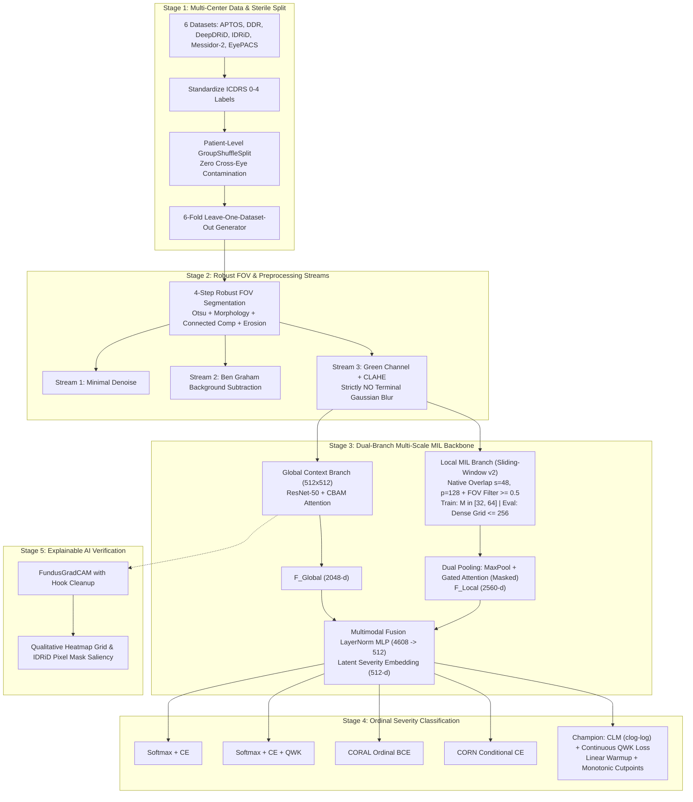

# End-to-End Pipeline Architecture: Multi-Scale Ordinal Multiple Instance Learning

> **Research Goal:** Construct an integrated, multi-scale deep learning framework combining Multiple Instance Learning (MIL) and Ordinal Regression (Cumulative Link Models) to resolve imaging domain shift and downsampling pixel-loss in diabetic retinopathy grading.  
> **Related Code Modules:** 
> - *Python Modules:* [`data_loader.py`](file:///d:/Github/deep-learning-for-computer-vision/notebooks/diabetic_retinopathy/pipeline/full/data_loader.py), [`preprocessing.py`](file:///d:/Github/deep-learning-for-computer-vision/notebooks/diabetic_retinopathy/pipeline/full/preprocessing.py), [`models.py`](file:///d:/Github/deep-learning-for-computer-vision/notebooks/diabetic_retinopathy/pipeline/full/models.py), [`losses_and_heads.py`](file:///d:/Github/deep-learning-for-computer-vision/notebooks/diabetic_retinopathy/pipeline/full/losses_and_heads.py), [`trainer.py`](file:///d:/Github/deep-learning-for-computer-vision/notebooks/diabetic_retinopathy/pipeline/full/trainer.py), [`visualization.py`](file:///d:/Github/deep-learning-for-computer-vision/notebooks/diabetic_retinopathy/pipeline/full/visualization.py).
> - *Experimental Notebooks:* [`main_model.ipynb`](file:///d:/Github/deep-learning-for-computer-vision/notebooks/diabetic_retinopathy/pipeline/model/main_model.ipynb), [`main_model_head_ablation.ipynb`](file:///d:/Github/deep-learning-for-computer-vision/notebooks/diabetic_retinopathy/pipeline/model/main_model_head_ablation.ipynb), [`main_model_lodo.ipynb`](file:///d:/Github/deep-learning-for-computer-vision/notebooks/diabetic_retinopathy/pipeline/model/main_model_lodo.ipynb), [`main_model_preprocessing_ablation.ipynb`](file:///d:/Github/deep-learning-for-computer-vision/notebooks/diabetic_retinopathy/pipeline/model/main_model_preprocessing_ablation.ipynb), [`merge-dataset.ipynb`](file:///d:/Github/deep-learning-for-computer-vision/notebooks/diabetic_retinopathy/pipeline/merge-dataset/merge-dataset.ipynb).

---

## 1. End-to-End System Architecture



---

## 2. Stage 1: Data Ingestion & Multi-Center Sterile Split

### 2.1. Unified Schema Harmonization
All 6 cohorts are parsed through `data_loader.py` into a standardized master metadata format:
`['image_id', 'diagnosis', 'dataset_name', 'dataset_key', 'image_file', 'raw_full_path', 'patient_id', 'side']`.
Namespacing with `f"{dataset_key}::{patient_id}"` ensures zero cross-dataset identifier collisions.

### 2.2. Two-Tier Storage & Sterile Partitioning
1. **Tier 1 (Harmonized Native Images):** Standardized images cropped to the retinal ROI are saved once under `hybrid/native_cropped/{dataset_key}/{image_id}.jpg` at JPEG quality 95.
2. **Tier 2 (Splitting Before Balancing):** The master dataset is partitioned into 70% Train, 15% Validation, and 15% Test using patient-level grouping (`GroupShuffleSplit`). Multi-source quota balancing is applied **strictly to the training pool** (`train_metadata.csv`), ensuring that Validation (`val_metadata.csv`) and Test (`test_metadata.csv`) sets preserve their natural clinical prevalence.

### 2.3. 6-Fold Leave-One-Dataset-Out (LODO) Execution
Implemented in [`main_model_lodo.ipynb`](file:///d:/Github/deep-learning-for-computer-vision/notebooks/diabetic_retinopathy/pipeline/model/main_model_lodo.ipynb):
* Iterates sequentially across 6 cross-domain folds:
  $$\text{Fold } k: \quad \mathcal{D}_{\text{OOD\_Test}} = \text{Dataset}_k, \quad \mathcal{D}_{\text{In\_Domain}} = \bigcup_{j \neq k} \text{Dataset}_j$$
* Primary transfer resilience metric:
  $$\Delta_{\text{QWK}} = \text{QWK}_{\text{In-Domain Val}} - \text{QWK}_{\text{OOD Test}}$$

---

## 3. Stage 2: Robust FOV Segmentation & Preprocessing Streams

```
                                  [Raw Fundus Image]
                                          │
                     4-Step Robust Retinal FOV Segmentation (compute_fov_mask)
                     1. Otsu's Adaptive Thresholding (vs. Fixed 'gray > 15')
                     2. Morphological Close + Open (Ellipse 25x25)
                     3. Largest Connected Component Extraction (Removes watermarks/glare)
                     4. Inward Morphological Erosion (erode_px = 15)
                                          │
                      ┌───────────────────┼───────────────────┐
                      ▼                   ▼                   ▼
                  Stream 1            Stream 2            Stream 3 (Proposed)
              Minimal Baseline       Ben Graham           Green Channel CLAHE
             (Bilateral Denoise)   (Gaussian Sub)    (Strictly NO Terminal Blur)
```

### 3.1. 4-Step Robust FOV Segmentation (`compute_fov_mask`)
Replaces brittle static thresholding (`gray > 15`) with a 4-stage optical segmentation pipeline:
1. **Otsu's Adaptive Thresholding:** Dynamically calculates the optimal bimodal intensity separation per image, preventing threshold collapse under non-standard sensor exposures.
2. **Morphological Close followed by Open:** Seals internal mask holes caused by dark vessel branches and bright reflective regions using a $25 \times 25$ elliptical structuring element, then removes isolated external noise.
3. **Largest Connected Component Extraction:** Strictly retains the primary circular retinal disk via `cv2.connectedComponentsWithStats`, eliminating calibration text, lens dust, and camera watermarks.
4. **Inward Morphological Erosion (`erode_px = 15`):** Strips away untrusted boundary vignetting and illumination halos at the camera perimeter.

### 3.2. Three Comparative Preprocessing Streams
1. **Stream 1 (Minimal Denoising):** Auto-crop ROI $\to$ Gentle bilateral filtering (`cv2.bilateralFilter(d=5, sigmaColor=30, sigmaSpace=30)`) $\to$ Resize.
2. **Stream 2 (Ben Graham Vasculature):** Auto-crop ROI $\to$ Local Gaussian background estimate $I_{\text{blur}}$ with $\sigma = W / 30$ $\to$ Subtraction:
   $$I_{\text{enhanced}} = 4 \cdot I - 4 \cdot I_{\text{blur}} + 128$$
3. **Stream 3 (Green Channel + CLAHE — Proposed):**
   * Extracts the **Green Channel** (maximal absorption contrast for hemoglobin at $\lambda \approx 540\text{nm}$).
   * Applies CLAHE (`clipLimit=2.0`, `tileGridSize=(8,8)`) directly to the Green Channel.
   * **Mandatory Rule:** Do NOT stack Ben Graham with CLAHE. **Strictly eliminate Gaussian smoothing** at the final stage to preserve focal microaneurysms ($\le 120\,\mu\text{m}$).

---

## 4. Stage 3: Dual-Branch Multi-Scale MIL Backbone

Module [`models.py`](file:///d:/Github/deep-learning-for-computer-vision/notebooks/diabetic_retinopathy/pipeline/full/models.py) and [`main_model.ipynb`](file:///d:/Github/deep-learning-for-computer-vision/notebooks/diabetic_retinopathy/pipeline/model/main_model.ipynb) implement two parallel, complementary streams:

```
                           [Native High-Resolution Fundus Image]
                                             │
                   ┌─────────────────────────┴─────────────────────────┐
                   ▼                                                   ▼
       [Global Context Branch (512x512)]           [Local Sliding-Window MIL Branch v2]
                   │                               - Patch Size: 128x128, Stride: s=48 px
               ResNet-50                           - Overlapping Scanning + FOV Filter >= 0.5
                   │                               - Train: Random M in [32, 64] patches/epoch
             CBAM Attention                        - Eval: Dense Full Grid (up to 256 patches)
                   │                                                   │
           F_Global (2048-d)                                    EfficientNet-B0
                   │                                                   │
                   │                                         Dual Aggregation Pooling:
                   │                                         1. 1D Max-Pooling (Grade 1 MA)
                   │                                         2. Gated Attention Pooling (Masked)
                   │                                                   │
                   │                                           F_Local (2560-d)
                   └─────────────────────────┬─────────────────────────┘
                                             ▼
                                [Multimodal Fusion (4608-d)]
                                             │
                                 LayerNorm Projection MLP
                                             │
                                 Latent Embedding (512-d)
                                             │
                         [Champion CLM_QWK Ordinal Regression Head]
```

### 4.1. Global Context Branch (ResNet-50 + CBAM Attention)
* **Input:** Full retinal view at $512 \times 512 \times 3$ (or $300 \times 300$).
* **Backbone:** ResNet-50 (ImageNet pretrained).
* **Attention Mechanism:** Convolutional Block Attention Module (CBAM) placed after Layer 4 ($2048$ channels):
  * *Channel Attention:*
    $$\mathbf{M}_c(F) = \sigma\Big(W_1\big(W_0(\text{AvgPool}(F))\big) + W_1\big(W_0(\text{MaxPool}(F))\big)\Big)$$
  * *Spatial Attention:*
    $$\mathbf{M}_s(F') = \sigma\Big(f^{7\times 7}\big([\text{AvgPool}(F'); \text{MaxPool}(F')]\big)\Big)$$
* **Output:** Global Average Pooling $\to F_{\text{Global}} \in \mathbb{R}^{2048}$.
* **Clinical Purpose:** Aggregates multi-focal hemorrhages and venous beading across all 4 retinal quadrants for **Grade 3 (Severe NPDR, $H_2$)**.

### 4.2. Local Multiple Instance Learning Branch (Sliding-Window v2 + EfficientNet-B0)
* **Sliding-Window Overlapping Extraction (`extract_mil_patches_sliding`):**
  * Replaces rigid $4 \times 4$ partitioning with a dense sliding window: patch size $p = 128$, stride $s = 48\text{ px}$ (overlap ratio $> 62\%$).
  * **Adaptive Retinal FOV Filtering:** Slices patch mask from `compute_fov_mask` and enforces $\text{mean}(\text{mask}_{\text{patch}}) \ge 0.5$, discarding uninformative black background and corner patches.
  * **Dual Operational Modes:**
    1. *Training Mode:* Stochastically samples $M \in [32, 64]$ patches per epoch from valid FOV candidates (spatial regularization + bounded VRAM budget).
    2. *Evaluation Mode:* Performs a dense sweep across the entire candidate grid (up to $256$ patches), guaranteeing zero missed micro-lesions.
* **Per-Patch Feature Encoding:** EfficientNet-B0 applied per patch $\to$ Global Average Pooling $\to (B, N, 1280)$.
* **Dual Aggregation Pooling with Masked Gated Attention:**
  1. *1D Max-Pooling:* Captures extreme focal microaneurysms for **Grade 1 ($H_1$)**:
     $$F_{\text{Max}} = \max_{k \in \{1 \dots N\}} f_{\text{patch}}^{(k)}$$
  2. *Masked Gated Attention Pooling:* Learns attention weights $a_k$ while strictly ignoring padding tokens via boolean `patch_mask` [Batch, $N_{\max}$]:
     $$a_k = \frac{\exp(w^T (\tanh(V h_k) \odot \sigma(U h_k)) + \text{mask\_bias}_k)}{\sum_{j=1}^N \exp(w^T (\tanh(V h_j) \odot \sigma(U h_j)) + \text{mask\_bias}_j)}, \quad F_{\text{Att}} = \sum_{k=1}^N a_k h_k$$
     where $\text{mask\_bias}_k = 0$ if valid, and $-10^4$ if padding.
* **Output:** Concatenated feature vector $F_{\text{Local}} = [F_{\text{Max}} \,\|\, F_{\text{Att}}] \in \mathbb{R}^{2560}$.

### 4.3. Multimodal Fusion Layer
* Concatenation: $F_{\text{Fused}} = [F_{\text{Global}} \,\|\, F_{\text{Local}}] \in \mathbb{R}^{4608}$.
* Nonlinear projection MLP (using `LayerNorm` for numerical stability across variable patch counts and small batch sizes):
  $$\text{Linear}(4608 \to 512) \to \text{LayerNorm} \to \text{Mish}() \to \text{Dropout}(0.3) \to \text{Linear}(512 \to 512) \to \text{LayerNorm}$$
* Output: Fused latent severity embedding $\mathbf{z} \in \mathbb{R}^{512}$.

---

## 5. Stage 4: Ordinal Classification & 5 Output Heads

### 5.1. Mathematical Formulation of the 5 Output Heads

| Head Configuration | Output Geometry | Loss Formulation | Clinical Ordinality |
| :--- | :--- | :--- | :--- |
| **1. Softmax_CE** | Categorical Logits via Linear(512, 5) | Standard Cross-Entropy | Non-ordinal (Rank violations observed) |
| **2. Softmax_QWK** | Categorical Logits via Linear(512, 5) | $\text{CE} + \lambda \cdot L_{\text{QWK}}$ | Quadratic distance penalty but unordered logits |
| **3. CORAL** | Consistent Rank Logits (Shared $w$, bias $b_k$) | Ordinal Binary CE | $P(y > k) = \sigma(w^T \mathbf{z} + b_k)$ (Violations if biases cross) |
| **4. CORN** | Conditional Ordinal NN | Conditional Binary CE | Cumulative product $P(y > k) = \prod_{j=0}^k P(y > j \mid y \ge j)$ |
| **5. CLM_QWK (Champion)** | Cumulative Link Model ($\text{clog-log}$) | Interval NLL $+ \lambda(t) L_{\text{QWK}}$ | **Optimal:** $0.0\%$ violations, asymmetric progression |

### 5.2. Mathematics of Champion CLM_QWK Head
* **Latent Severity Score:** Scalar linear projection $s(\mathbf{x}) = \mathbf{w}^T \mathbf{z}$.
* **Monotonic Cutpoints:** Parameterized via positive softplus increments:
  $$\theta_1 \in \mathbb{R}, \quad \theta_{k+1} = \theta_k + \text{softplus}(\alpha_k) + 10^{-4} \quad (k = 1, 2, 3)$$
* **Complementary Log-Log ($\text{clog-log}$) Link Function:**
  $$P(Y \le k) = F(\theta_k - s(\mathbf{x})) = 1 - \exp(-\exp(\theta_k - s(\mathbf{x})))$$
* **Hybrid Objective with Linear Warmup:**
  $$\mathcal{L}_{\text{CLM\_QWK}} = \mathcal{L}_{\text{NLL}}(\mathbf{p}, \mathbf{y}) + \lambda(t) \cdot \mathcal{L}_{\text{Continuous\_QWK}}(\mathbf{p}, \mathbf{y})$$
  where $\lambda(t) = \min\left(1.0, \frac{t}{T_{\text{warmup}}}\right) \cdot \lambda_{\text{target}}$.

---

## 6. Stage 5: Explainable AI Verification (FundusGradCAM)

* **Target Layer:** Layer 4 ($2048$ channels) of the ResNet-50 Global Context Branch.
* **Hook Lifecycle Safety:** Forward/backward activation hooks are explicitly removed post-computation using registered handles to prevent GPU VRAM leaks during long evaluation runs.
* **Clinical Saliency Verification:** Evaluated qualitatively on multi-quadrant hemorrhages and compared with ground-truth lesion masks on the IDRiD dataset.
