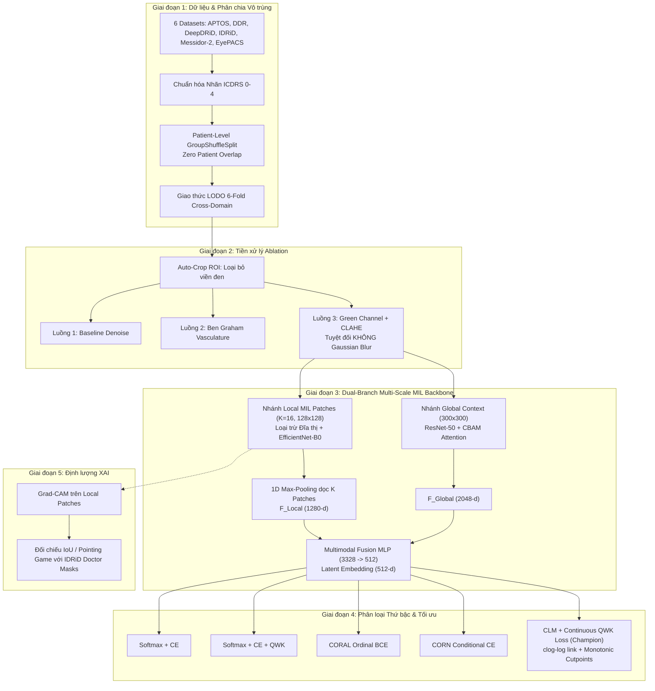

# Kiến Trúc Pipeline Xử Lý Hoàn Chỉnh: Multi-Scale Ordinal Multiple Instance Learning

> **Mục tiêu nghiên cứu:** Xây dựng khung kiến trúc Deep Learning đa tỷ lệ kết hợp học đa thể nghiệm (Multiple Instance Learning - MIL) và hồi quy thứ bậc (Ordinal Regression) để giải quyết triệt để bài toán Domain Shift và sụp đổ độ phân giải trong phân loại võng mạc tiểu đường.  
> **Mã nguồn liên quan:** [`data_loader.py`](file:///d:/Github/deep-learning-for-computer-vision/notebooks/diabetic_retinopathy/pipeline/full/data_loader.py), [`preprocessing.py`](file:///d:/Github/deep-learning-for-computer-vision/notebooks/diabetic_retinopathy/pipeline/full/preprocessing.py), [`models.py`](file:///d:/Github/deep-learning-for-computer-vision/notebooks/diabetic_retinopathy/pipeline/full/models.py), [`losses_and_heads.py`](file:///d:/Github/deep-learning-for-computer-vision/notebooks/diabetic_retinopathy/pipeline/full/losses_and_heads.py), [`baselines.py`](file:///d:/Github/deep-learning-for-computer-vision/notebooks/diabetic_retinopathy/pipeline/full/baselines.py), [`trainer.py`](file:///d:/Github/deep-learning-for-computer-vision/notebooks/diabetic_retinopathy/pipeline/full/trainer.py).

---

## 1. Sơ Đồ Tổng Thể Pipeline (End-to-End Architecture)



---

## 2. Giai Đoạn 1: Hợp Nhất & Phân Chia Vô Trùng Tuyệt Đối (Strict Sterile Split)

### 2.1. Hợp Nhất & Chuẩn Hóa
Toàn bộ dữ liệu từ 6 nguồn được nạp thông qua [`data_loader.py`](file:///d:/Github/deep-learning-for-computer-vision/notebooks/diabetic_retinopathy/pipeline/full/data_loader.py) thành DataFrame thống nhất có cấu trúc:
`['image_id', 'level', 'dataset', 'image_file', 'full_path', 'patient_id', 'side']`.

### 2.2. Phân Chia Cấp Độ Bệnh Nhân (Patient-Level Grouping)
Thay vì sử dụng phân chia ngẫu nhiên thông thường (Stratified Split theo ảnh), hệ thống bắt buộc gom nhóm theo `patient_id`:
* Nếu một bệnh nhân có cả 2 mắt (Left & Right) hoặc nhiều ảnh chụp (như trong DeepDRiD), **toàn bộ các ảnh của bệnh nhân đó phải cùng nằm trong tập Train hoặc cùng nằm trong tập Test/Validation**.
* Sử dụng `GroupShuffleSplit` trong `split_train_val_by_patient()` và kiểm tra điều kiện giao thoa $S_{\text{Train}} \cap S_{\text{Val}} = \emptyset$.

### 2.3. Giao Thức Đánh Giá Ngoại Miền LODO (Leave-One-Dataset-Out)
Để kiểm chứng độ bền bỉ trước Domain Shift:
* Hệ thống sinh ra 6 Fold thực nghiệm liên tiếp (`leave_one_dataset_out_generator`).
* Trong mỗi Fold, 1 dataset hoàn chỉnh được giữ lại làm **Tập Kiểm Thử Ngoại Miền Cách Ly Tuyệt Đối (OOD Test Set)**, không bao giờ xuất hiện trong quá trình huấn luyện.
* 5 dataset còn lại được gộp làm tập In-Domain, sau đó chia Train/Val (85%/15%) theo cấp độ bệnh nhân.

---

## 3. Giai Đoạn 2: Tiền Xử Lý Như Một Biến Số Ablation (Preprocessing Study)

Mô đun [`preprocessing.py`](file:///d:/Github/deep-learning-for-computer-vision/notebooks/diabetic_retinopathy/pipeline/full/preprocessing.py) thiết lập 3 luồng tiền xử lý độc lập để kiểm chứng giả thuyết thực nghiệm:

```
                      ┌──► Luồng 1 (Baseline): Bilateral Denoise + Resize
                      │
[Ảnh Gốc] ──► Auto-Crop ROI ──┼──► Luồng 2 (Ben Graham): Trừ nền cục bộ (Vascular enhancement)
                      │
                      └──► Luồng 3 (Green Channel + CLAHE): Tăng tương phản tổn thương vi mô
                                 (BẢO TOÀN SẮC NÉT - BỎ HOÀN TOÀN GAUSSIAN BLUR Ở BƯỚC CUỐI)
```

### 3.1. Auto-Crop ROI Tự Động (`crop_fundus_roi`)
* Phát hiện và cắt bỏ hoàn toàn viền đen vô nghĩa xung quanh đĩa võng mạc bằng mặt nạ ngưỡng thích nghi (`intensity > tol`), định tâm và trả về khung bao sát đĩa thị võng mạc.

### 3.2. Ba Luồng Tiền Xử Lý So Sánh Ablation
1. **Luồng 1 (Baseline - Khử nhiễu cơ bản):**
   * Auto-crop ROI $\to$ Lọc khử nhiễu song phương nhẹ (`cv2.bilateralFilter(d=5, sigmaColor=30, sigmaSpace=30)`) $\to$ Resize.
2. **Luồng 2 (Ben Graham - Trừ nền cục bộ):**
   * Auto-crop ROI $\to$ Làm mờ Gaussian nền cục bộ $I_{\text{blur}}$ với $\sigma = W / 30$ $\to$ Trừ nền có trọng số:
     $$I_{\text{enhanced}} = 4 \cdot I - 4 \cdot I_{\text{blur}} + 128$$
   * Tác dụng: Chuẩn hóa màu sắc giữa các camera, làm nổi bật mạng lưới mạch máu lớn.
3. **Luồng 3 (Green Channel + CLAHE - Tối ưu cho Vi phình mạch):**
   * Chuyển đổi sang không gian màu $LAB$, tách kênh độ sáng $L$ (Luminance).
   * Áp dụng CLAHE (`clipLimit=2.5`, `tileGridSize=(8,8)`) lên kênh $L$ để cân bằng độ sáng mà không làm biến đổi sắc độ màu.
   * Tách và áp dụng CLAHE trực tiếp lên **Kênh Xanh Lá (Green Channel)** - kênh có độ hấp thụ ánh sáng quang học chênh lệch lớn nhất giữa huyết cầu tố trong vi phình mạch/xuất huyết và biểu mô võng mạc.
   * Tái cấu trúc ảnh RGB sắc nét.
   * **NGUYÊN TẮC BẮT BUỘC:** **Không xếp chồng Ben Graham với CLAHE** (tránh khuếch đại nhiễu quá mức). **Bỏ hoàn toàn bước Gaussian Blur ở cuối luồng CLAHE** để tránh xóa sổ các chấm vi phình mạch siêu nhỏ (tổn thương quyết định của Lớp 1).

---

## 4. Giai Đoạn 3: Trích Xuất Đặc Trưng Lai Đa Tỷ Lệ (Global Context + MIL Local)

Mô đun [`models.py`](file:///d:/Github/deep-learning-for-computer-vision/notebooks/diabetic_retinopathy/pipeline/full/models.py) thiết kế kiến trúc 2 nhánh song song:

### 4.1. Nhánh Toàn Cục (Global Context Branch)
* **Đầu vào:** Ảnh võng mạc toàn thể kích thước $300 \times 300 \times 3$.
* **Backbone:** ResNet-50 (Pretrained ImageNet).
* **Cơ chế Attention:** Khối **CBAM (Convolutional Block Attention Module)** đặt tại đầu ra của Layer 4 (2048 channels).
  * *Channel Attention:* Kết hợp AvgPool & MaxPool qua Shared MLP $\to \sigma(W_1(W_0(F_{\text{avg}})) + W_1(W_0(F_{\text{max}})))$.
  * *Spatial Attention:* Tích chập $7 \times 7$ trên kết hợp AvgPool & MaxPool theo chiều kênh.
* **Đầu ra:** Global Average Pooling (GAP) $\to F_{\text{Global}} \in \mathbb{R}^{2048}$.
* **Ý nghĩa lâm sàng:** Bắt trọn ngữ cảnh toàn cục, quy tắc phân bố 4 góc phần tư cho **Lớp 3 (Severe NPDR)**.

### 4.2. Nhánh Cục Bộ Đa Thể Nghiệm (Local MIL Branch)
* **Sửa lỗi cơ chế Smart Crop cũ:** Kỹ thuật Smart Crop cũ chọn vùng có phương sai/entropy cao nhất, dẫn đến việc luôn bị hút vào Đĩa thị (Optic Disc) và cuống mạch máu lớn (những vùng không mang thông tin bệnh lý). Hệ thống khắc phục bằng cách sử dụng lưới cửa sổ trượt $K=16$ patches (kích thước $128 \times 128$) quét toàn bộ diện tích võng mạc hoặc dùng Mask che đĩa thị.
* **Đầu vào:** $K=16$ patches độ phân giải cao $(B, K=16, 3, 128, 128)$.
* **Backbone:** EfficientNet-B0 (Pretrained ImageNet).
* **Reshape Trick song song trên GPU:** Gộp chiều batch và patch $(B \cdot K, 3, 128, 128) \to$ Trích xuất đặc trưng $\to$ Unflatten trở lại $(B, K, 1280)$.
* **MIL Max-Pooling:** Thực hiện 1D Max-Pooling dọc theo chiều $K=16$ patches:
  $$F_{\text{Local}}^{(c)} = \max_{k \in \{1 \dots K\}} f_{\text{patch}}^{(k, c)}, \quad \forall c \in \{1 \dots 1280\}$$
* **Đầu ra:** Vector đặc trưng cục bộ $F_{\text{Local}} \in \mathbb{R}^{1280}$.
* **Ý nghĩa lâm sàng:** Nắm bắt dấu hiệu vi phình mạch và xuất huyết nhỏ nhất của **Lớp 1 (Mild DR)** mà không bị mất dấu do downsampling.

### 4.3. Tầng Dung Hợp Đa Tỷ Lệ (Multimodal Fusion Layer)
* Ghép nối đặc trưng: $F_{\text{Fused}} = [F_{\text{Global}} \,\|\, F_{\text{Local}}] \in \mathbb{R}^{3328}$.
* Chiếu phi tuyến qua 2 tầng MLP:
  $$\text{Linear}(3328 \to 512) \to \text{BatchNorm1d} \to \text{Mish}() \to \text{Dropout}(0.3) \to \text{Linear}(512 \to 512) \to \text{LayerNorm}$$
* Trả về không gian nhúng tiềm ẩn chung: $D_{\text{Latent}} \in \mathbb{R}^{512}$.

---

## 5. Giai Đoạn 4: Phân Loại Thứ Bậc & Tối Ưu Hóa (Ordinal Heads & Losses)

Mô đun [`losses_and_heads.py`](file:///d:/Github/deep-learning-for-computer-vision/notebooks/diabetic_retinopathy/pipeline/full/losses_and_heads.py) hỗ trợ 5 cấu hình đầu ra nhằm phân tích triệt để bài toán hồi quy thứ bậc:

| Cấu hình Head | Bản chất toán học | Hàm mất mát (Loss Function) | Tính chất thứ bậc y khoa |
| :--- | :--- | :--- | :--- |
| **1. Softmax_CE** | Categorical Logits độc lập qua Linear(512, 5) | Cross-Entropy Loss chuẩn | ❌ Mất hoàn toàn thứ bậc (phạt nhầm Lớp 0 $\to$ 4 bằng Lớp 0 $\to$ 1) |
| **2. Softmax_QWK** | Categorical Logits qua Linear(512, 5) | $\text{CE} + \lambda \cdot L_{\text{QWK}}$ | ⚠️ Có phạt khoảng cách nhưng vẫn dùng phân bố độc lập |
| **3. CORAL** | Consistent Rank Logits: Trọng số $W$ chung, 4 ngưỡng $b_k$ | Ordinal Binary Cross-Entropy trên 4 ngưỡng | ✅ Đảm bảo rank logits, $P(y > k) = \sigma(W^T x + b_k)$ |
| **4. CORN** | Conditional Ordinal Regression NN | Conditional Binary Cross-Entropy | ✅ Chuỗi xác suất có điều kiện $P(y > k \mid y \ge k)$ |
| **5. CLM_QWK (Champion)** | Cumulative Link Model với hàm liên kết Complementary Log-Log (clog-log) | Interval NLL Loss $+ \lambda \cdot L_{\text{QWK}}$ | 🏆 **Tối ưu nhất:** Đơn điệu tuyệt đối, nhạy bén với sự lệch phân bố y khoa |

### 5.1. Toán Học Của Mô Hình Vô Địch (Champion CLM_QWK)

1. **Điểm nghiêm trọng tiềm ẩn (Latent Severity Score):**
   $$s(x) = W^T x \in \mathbb{R} \quad (\text{Chiếu từ } \mathbb{R}^{512} \to \text{vô hướng})$$
2. **Các điểm cắt đơn điệu nghiêm ngặt (Strictly Monotonic Cutpoints):**
   $$\theta_1 < \theta_2 < \theta_3 < \theta_4$$
   Được tham số hóa qua bước tăng Softplus dương: $\theta_k = \theta_{k-1} + \text{softplus}(\Delta_k) + 10^{-4}$.
3. **Hàm liên kết Complementary Log-Log (clog-log):**
   $$F(z) = 1 - \exp(-\exp(z))$$
4. **Xác suất tích lũy & Xác suất khoảng:**
   $$P(Y \le k) = 1 - \exp(-\exp(\theta_k - s(x)))$$
   $$P(Y = k) = P(Y \le k) - P(Y \le k-1)$$
5. **Hàm mất mát tổng hợp:**
   $$\mathcal{L}_{\text{Total}} = -\sum_{i=1}^B \log P(Y = y_i) + \lambda \cdot \mathcal{L}_{\text{QWK}}$$

### 5.2. Hàm Mất Mát Khả Vi QWK (Continuous Differentiable QWK Loss)
* Ma trận trọng số phạt bậc hai: $W_{ij} = \frac{(i - j)^2}{(C - 1)^2}$ (với $C=5$).
* Ma trận nhầm lẫn quan sát mềm: $O = \frac{1}{N} P^T Y$.
* Ma trận nhầm lẫn kỳ vọng ngẫu nhiên: $E = \text{hist}_{\text{pred}}^T \cdot \text{hist}_{\text{true}}$.
* Tổn thất khả vi:
  $$\mathcal{L}_{\text{QWK}} = \frac{\sum_{i,j} W_{ij} O_{ij}}{\sum_{i,j} W_{ij} E_{ij} + \epsilon}$$

---

## 6. Giai Đoạn 5: Định Lượng XAI (Quantitative Explainable AI)

Hệ thống tích hợp công cụ giải thích trực quan Grad-CAM trên nhánh Local Patches và đối chiếu định lượng:
* **Đối chiếu với Ground-Truth Segmentation Mask:** Sử dụng 455 ảnh của tập IDRiD (tập dữ liệu duy nhất có mask chuyên gia khoanh vùng pixel cho Vi phình mạch, Xuất huyết, Xuất tiết cứng và Bông võng mạc).
* **Chỉ số IoU (Intersection over Union) & Pointing Game:**
  * Binarize bản đồ nhiệt Grad-CAM tại ngưỡng thích nghi $T$.
  * Tính $\text{IoU} = \frac{\text{Heatmap} \cap \text{Doctor\_Mask}}{\text{Heatmap} \cup \text{Doctor\_Mask}}$.
  * Kiểm chứng Pointing Game: Điểm cực đại của Attention Heatmap có rơi trúng vào tổn thương vi mạch hay không (chứng minh mô hình không nhìn vào đĩa thị hay nhiễu ảnh).

---

## 7. Hệ Thống Mô Hình Đối Chuẩn (Benchmark Baselines)

Mô đun [`baselines.py`](file:///d:/Github/deep-learning-for-computer-vision/notebooks/diabetic_retinopathy/pipeline/full/baselines.py) xây dựng hệ thống mô hình so sánh đa tầng:

### Tier 1: Single Anchor Baselines (Mô hình đơn nhánh nền tảng)
1. **ResNet50_Baseline:** Mạng ResNet-50 chuẩn ImageNet (đối chuẩn cho nhánh Global đơn lẻ).
2. **EfficientNetB0_Baseline:** Mạng EfficientNet-B0 chuẩn (đối chuẩn cho nhánh ảnh toàn thể không có MIL).
3. **DenseNet121_Baseline:** Mạng DenseNet-121 đánh giá hiệu quả tái sử dụng đặc trưng liên kết dày đặc.

### Tier 2: Complex SOTA Baselines (Mô hình phức hợp tiên tiến)
4. **EfficientNetB0_MSAG:** Tích hợp cổng chú ý đa tỷ lệ (**Multi-Scale Attention Gate**) với các nhánh tích chập giãn nở song song (Dilation rate $1, 2, 4$).
5. **Hybrid_EffB0_ViT:** Kết hợp CNN EfficientNet-B0 trích xuất đặc trưng với khối **Vision Transformer (ViT)** tự chú ý toàn cục (Transformer Encoder 3 lớp, 8 heads, Learnable [CLS] token).
6. **EfficientNetB3_Baseline:** Mạng dung lượng cao xử lý ảnh độ phân giải lớn hơn.
7. **DFD_Net_Nominal:** Mô hình 2 nhánh song song (ResNet34 + EfficientNet-B0) nhưng **không sử dụng cơ chế MIL** (dùng Average Pooling thông thường) và đầu ra là phân loại Softmax danh nghĩa.

---

## 8. Bộ Metric Đánh Giá Bắt Buộc (`trainer.py`)

Trong [`trainer.py`](file:///d:/Github/deep-learning-for-computer-vision/notebooks/diabetic_retinopathy/pipeline/full/trainer.py), mỗi thử nghiệm LODO đều được ghi nhận đầy đủ bộ chỉ số y khoa toàn diện:

1. **Quadratic Weighted Kappa (QWK):** Chỉ số chính đánh giá mức độ đồng thuận thứ bậc giữa bác sĩ và AI.
2. **$\Delta_{\text{QWK}}$ (Domain Shift Drop - Metric Headline):**
   $$\Delta_{\text{QWK}} = \text{QWK}_{\text{In-Domain Val}} - \text{QWK}_{\text{OOD Test}}$$
   *Giá trị $\Delta_{\text{QWK}}$ càng nhỏ chứng minh mô hình càng bền bỉ trước sự thay đổi thiết bị và miền dữ liệu.*
3. **Within-1-Grade Accuracy:** Tỷ lệ dự đoán sai lệch không quá $\pm 1$ cấp độ severity (tiêu chuẩn dung sai lâm sàng).
4. **Referable DR Sensitivity & Specificity:** Đánh giá phát hiện các ca bệnh cần chuyển tuyến chuyên khoa (Grade $\ge 2$).
5. **Per-Grade Recall:** Bắt buộc báo cáo chi tiết cho từng lớp $0, 1, 2, 3, 4$ (đặc biệt theo dõi sát sao Lớp 1 và Lớp 3).
6. **Rank Monotonicity Violations:** Tỷ lệ mẫu vi phạm tính đơn điệu xác suất tích lũy $P(Y \le 0) \le P(Y \le 1) \le \dots \le P(Y \le 4)$.
