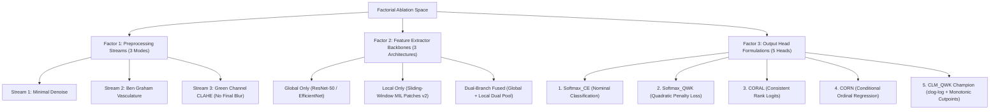

# Factorial Baseline & Domain Shift Experimental Framework

> **Research Goal:** Systematic factorial decomposition of domain shift in diabetic retinopathy grading through controlled ablation of backbones, preprocessing pipelines, and ordinal output heads.  
> **Related Code Modules:** 
> - *Python Modules:* [`models.py`](file:///d:/Github/deep-learning-for-computer-vision/notebooks/diabetic_retinopathy/pipeline/full/models.py), [`losses_and_heads.py`](file:///d:/Github/deep-learning-for-computer-vision/notebooks/diabetic_retinopathy/pipeline/full/losses_and_heads.py), [`trainer.py`](file:///d:/Github/deep-learning-for-computer-vision/notebooks/diabetic_retinopathy/pipeline/full/trainer.py), [`visualization.py`](file:///d:/Github/deep-learning-for-computer-vision/notebooks/diabetic_retinopathy/pipeline/full/visualization.py).
> - *Ablation Notebooks:* [`main_model_head_ablation.ipynb`](file:///d:/Github/deep-learning-for-computer-vision/notebooks/diabetic_retinopathy/pipeline/model/main_model_head_ablation.ipynb), [`main_model_preprocessing_ablation.ipynb`](file:///d:/Github/deep-learning-for-computer-vision/notebooks/diabetic_retinopathy/pipeline/model/main_model_preprocessing_ablation.ipynb), [`main_model_lodo.ipynb`](file:///d:/Github/deep-learning-for-computer-vision/notebooks/diabetic_retinopathy/pipeline/model/main_model_lodo.ipynb).

---

## 1. Controlled Experimental Dimensions

To isolate the independent and interaction effects governing external generalization collapse, the empirical framework constructs a $3 \times 3 \times 5$ factorial space:

---

## 2. Factor 1: Preprocessing Stream Ablation ($H_4$)

| Preprocessing Mode | Optical Rationale | Targeted Lesions | Risk / Negative Control |
| :--- | :--- | :--- | :--- |
| **Mode 1: Minimal Baseline** | Auto-crop ROI + Bilateral Denoise + Standard Resize | General retina outline | Low contrast on dark fundus |
| **Mode 2: Ben Graham** | Local Gaussian background subtraction ($I - I_{\text{blur}}$) | Major vessel arcades | Over-amplifies optical flash glare |
| **Mode 3: Green Channel CLAHE** | Maximizes hemoglobin absorption contrast ($\lambda \approx 540\text{nm}$) | Focal microaneurysms ($\le 120\,\mu\text{m}$) | **Strictly NO final Gaussian smoothing** |

---

## 3. Factor 2: Multi-Scale Architectural Backbone Ablation ($H_1, H_2$)

1. **Global Context Branch ($512 \times 512$):** ResNet-50 with CBAM attention. Encodes multi-quadrant hemorrhage density and venous beading for **Grade 3 ($H_2$)**.
2. **Local MIL Branch (Sliding-Window v2):** EfficientNet-B0 scanning native-resolution overlapping $128 \times 128$ patches (stride $s=48$, retinal FOV filter $\ge 0.5$) with Dual Aggregation (Max-Pooling + Masked Gated Attention). Preserves native-resolution focal microaneurysms for **Grade 1 ($H_1$)**.
3. **Dual-Branch Fused Model:** Multimodal concatenation projected through a 2-layer LayerNorm MLP to a $512\text{-d}$ shared latent representation.

---

## 4. Factor 3: Output Head & Ordinal Regression Ablation ($H_3$)

### 4.1. 5-Round End-to-End ResNet-50 Training Protocol

To establish a strictly fair, uncompromised benchmark for Hypothesis $H_3$, the experimental protocol enforces **independent end-to-end training loops** across all 5 head formulations on a standardized **ResNet-50** backbone:

$$\begin{aligned}
\text{Round 1:} &\quad \text{ResNet-50 (Freshly Initialized)} + \text{Softmax\_CE} \longrightarrow \text{End-to-End Optimization} \\
\text{Round 2:} &\quad \text{ResNet-50 (Freshly Initialized)} + \text{Softmax\_QWK} \longrightarrow \text{End-to-End Optimization} \\
\text{Round 3:} &\quad \text{ResNet-50 (Freshly Initialized)} + \text{CORAL} \longrightarrow \text{End-to-End Optimization} \\
\text{Round 4:} &\quad \text{ResNet-50 (Freshly Initialized)} + \text{CORN} \longrightarrow \text{End-to-End Optimization} \\
\text{Round 5:} &\quad \text{ResNet-50 (Freshly Initialized)} + \text{CLM\_QWK} \longrightarrow \text{End-to-End Optimization}
\end{aligned}$$

#### Controlled Confounding Elimination:
- **Zero Shared Latent Bias:** Pre-extracted cached latent representations from a Softmax-trained backbone introduce structural bias against ordinal link functions. Training each head from scratch ensures the backbone feature representations adapt dynamically to each head's specific decision geometry.
- **Architectural Standardization:** All 5 rounds utilize identical ResNet-50 layers, identical $300 \times 300$ input dimensions, identical Green-channel Ben Graham preprocessing, identical AdamW optimizer hyperparameters ($\text{lr} = 10^{-4}, \text{weight decay} = 10^{-3}$), and identical Cosine Annealing schedules.
- **Controlled Independent Variable:** The loss formulation and output decision layer are the sole independent variables across rounds.

---

### 4.2. Mathematical Formulations & Rank Monotonicity Guarantees

| Output Head | Mathematical Formulation | Loss Function | Monotonicity Guarantee |
| :--- | :--- | :--- | :--- |
| **1. Softmax_CE** | $P(y = k) = \frac{\exp(z_k)}{\sum_j \exp(z_j)}$ | Categorical Cross-Entropy | **None** ($P(y > k)$ frequently crosses) |
| **2. Softmax_QWK** | $P(y = k) = \text{Softmax}(z_k)$, $\hat{y} = \sum k \cdot p_k$ | $\text{CE} + \lambda \mathcal{L}_{\text{QWK}}$ | **Soft penalty only** (no structural guarantee) |
| **3. CORAL** | $P(y > k) = \sigma(\mathbf{w}^T \mathbf{z} + b_k)$ with unconstrained biases $b_k$ | $\sum_k \text{BCE}(\sigma(\mathbf{w}^T \mathbf{z} + b_k), \mathbb{I}(y > k))$ | **None** (biases can invert during training) |
| **4. CORN** | $P(y > k \mid y \ge k) = \sigma(c_k)$, $P(y > k) = \prod_{j=0}^k \sigma(c_j)$ | $\sum_k \mathbb{I}(y \ge k) \text{BCE}(\sigma(c_k), \mathbb{I}(y > k))$ | **Guaranteed non-increasing** by cumulative product |
| **5. CLM_QWK (Champion)** | $P(Y \le k) = 1 - \exp(-\exp(\theta_k - \mathbf{w}^T \mathbf{z}))$ with $\theta_1 < \dots < \theta_4$ | Interval $\text{NLL} + \lambda(t) \mathcal{L}_{\text{QWK}}$ with warmup | **Strictly monotonic** by softplus cutpoint increments |

---

### 4.3. Rank Monotonicity Violation Audit Protocol

In clinical ophthalmology, a valid ordinal risk model must satisfy the non-increasing property for exceeding disease severity thresholds:
$$P(y > 0) \ge P(y > 1) \ge P(y > 2) \ge P(y > 3)$$

To prevent artificial suppression of violations via positive rectifiers (such as `F.relu`), the auditing metric inspects **pre-activation rank probabilities** across all patient samples $i \in \{1 \dots N\}$:
$$\Delta_{i, k} = P(y_i > k+1) - P(y_i > k)$$

A clinical violation is registered if $\exists k \in \{0, 1, 2\}: \Delta_{i, k} > 10^{-4}$. The overall violation rate is computed as:
$$\text{Monotonicity Violation Rate} = \frac{1}{N} \sum_{i=1}^{N} \mathbb{I}\left( \max_{k} \Delta_{i, k} > 10^{-4} \right) \times 100\%$$

---

## 5. Domain Shift Quantification Metric Framework

For any evaluation metric $\mathcal{M}$ (such as Quadratic Weighted Kappa, Referable Sensitivity, or Grade 1 Recall):
$$\Delta_{\mathcal{M}} = \mathcal{M}_{\text{In-Domain Validation}} - \mathcal{M}_{\text{External OOD Test}}$$

A resilient architecture exhibits minimal $\Delta_{\text{QWK}}$ while maintaining high in-domain fidelity and strict clinical rank consistency ($0.0\%$ monotonicity violations).
