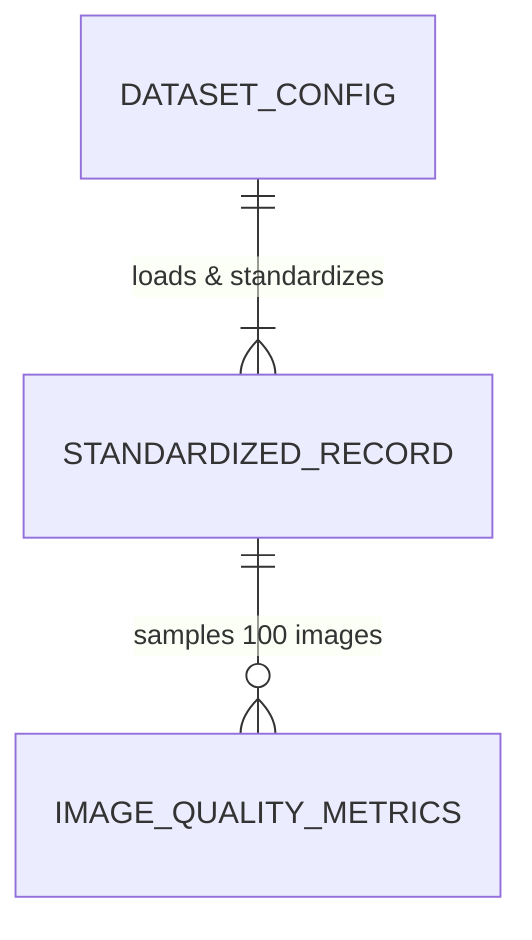

# Data Model & Schema Specification: 6 DR Datasets EDA

## 1. Core Data Entities

### DatasetConfig
Represents configuration settings for each of the 6 raw DR datasets.

| Field Name | Type | Description | Validation / Constraints |
| :--- | :--- | :--- | :--- |
| `name` | `str` | Display name of dataset | Non-empty (e.g., "APTOS 2019") |
| `image_dir` | `str` | Relative directory path to images | Must resolve relative to `data/raw/` |
| `csv_path` | `str` | Relative path to label CSV file | Must resolve relative to `data/raw/` |
| `id_col` | `str` | Original CSV image ID column name | String present in CSV header |
| `label_col` | `str` | Original CSV DR grade column name | String present in CSV header |
| `id_suffix` | `str` | Image file extension if omitted in CSV | e.g., `.png`, `.jpg`, or `""` |

---

### StandardizedRecord
Unified tabular representation produced after loading and standardizing raw dataset labels.

| Field Name | Type | Description | Validation / Constraints |
| :--- | :--- | :--- | :--- |
| `dataset_name` | `str` | Source dataset key | One of: `aptos`, `ddr`, `deepdrid`, `idrid`, `messidor2`, `eyepacs` |
| `image_id` | `str` | Unified image file identifier | Non-null, unique within dataset |
| `level` | `int` | Standardized DR severity grade | Integer $\in \{0, 1, 2, 3, 4\}$ |
| `patient_id` | `str` (Optional) | Extracted patient identifier | Parsed from `image_id` if lateral naming present |
| `eye_side` | `str` (Optional) | Eye orientation | `"left"`, `"right"`, or `"unknown"` |
| `is_valid` | `bool` | Data integrity check status | `True` if grade $\in [0..4]$ and `image_id` non-null |

---

### ImageQualityMetrics
Data structure holding image property samples (100 samples per dataset).

| Field Name | Type | Description | Range / Units |
| :--- | :--- | :--- | :--- |
| `dataset_name` | `str` | Source dataset key | String |
| `image_id` | `str` | Image file identifier | String |
| `width` | `int` | Native image width | Positive integer (pixels) |
| `height` | `int` | Native image height | Positive integer (pixels) |
| `aspect_ratio` | `float` | Width / Height ratio | Float (typically $1.0$ to $1.5$) |
| `brightness` | `float` | Mean grayscale pixel intensity | Float $[0.0, 255.0]$ |
| `sharpness` | `float` | Laplacian variance focus score | Float $\ge 0.0$ |

## 2. Relationships

## 3. Data Transformations & Pipelines

1. **Schema Standardization**:
   - `id_col` $\rightarrow$ `image_id`
   - `label_col` $\rightarrow$ `level` (cast to integer)
2. **Patient & Eye Lateral Parsing**:
   - Matches regex `r"(\d+)_(left|right)"` or checks `"left"` / `"right"` substring in `image_id`.
3. **Quality Metric Calculation**:
   - `brightness = np.mean(cv2.cvtColor(rgb_image, cv2.COLOR_RGB2GRAY))`
   - `sharpness = cv2.Laplacian(gray_image, cv2.CV_64F).var()`
