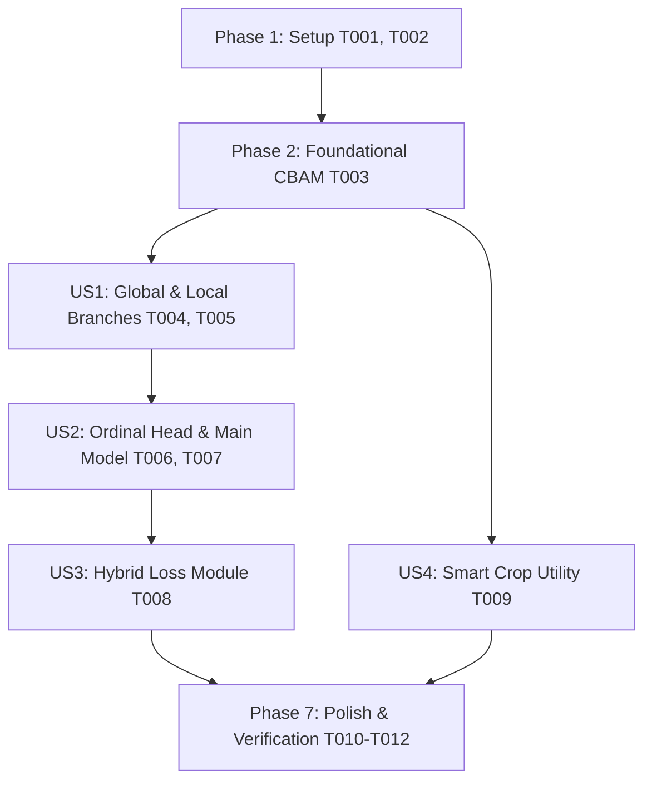

# Tasks: Multi-Scale All-CNN Hybrid Extractor for Diabetic Retinopathy Grading

**Input**: Design documents from `specs/003-dr-multiscale-hybrid-extractor/`

**Prerequisites**: plan.md, spec.md, research.md, data-model.md, contracts/model_interface.md, quickstart.md

**Organization**: Tasks are grouped by user story (US1, US2, US3, US4) to enable independent implementation, verification, and testing.

## Format: `- [ ] [TaskID] [P?] [Story?] Description with file path`

- **[P]**: Can run in parallel (different files or independent modules)
- **[US#]**: Which user story this task belongs to

---

## Phase 1: Setup (Shared Infrastructure)

**Purpose**: Environment and project structure initialization

- [x] T001 Verify PyTorch and torchvision dependencies in environment
- [x] T002 Create module directory structure `src/models/` for deep learning models

---

## Phase 2: Foundational (Blocking Prerequisites)

**Purpose**: Core base modules required by all feature branches

- [x] T003 [P] Implement `CBAM` Attention Module (ChannelAttention + SpatialAttention) in `src/models/multiscale_hybrid_extractor.py`

---

## Phase 3: User Story 1 - Multi-Scale Feature Extraction and Representation (Priority: P1) 🎯 MVP

**Goal**: Extract macroscopic global context ($F_{\text{global}} \in \mathbb{R}^{2048}$) and local high-res patch features ($F_{\text{local}} \in \mathbb{R}^{1280}$) using dual-branch ResNet50 + CBAM and EfficientNet-B0 + MaxPool aggregation.

**Independent Test**: Pass `img_global` `[B, 3, 224, 224]` and `patches_local` `[B, K, 3, 128, 128]` into `GlobalBranch` and `LocalBranch` to verify feature output shapes `[B, 2048]` and `[B, 1280]`.

### Implementation for User Story 1

- [x] T004 [P] [US1] Implement `GlobalBranch` with ResNet50 backbone + CBAM attention in `src/models/multiscale_hybrid_extractor.py`
- [x] T005 [P] [US1] Implement `LocalBranch` with EfficientNet-B0 backbone + reshape trick + patch max-pooling in `src/models/multiscale_hybrid_extractor.py`

**Checkpoint**: User Story 1 dual feature extraction branches functional and testable independently.

---

## Phase 4: User Story 2 - Consistent Rank Logits (CORAL) Ordinal Classification (Priority: P2)

**Goal**: Fuse global and local features via 2-layer MLP and output 4 binary logits for CORAL ordinal regression $P(y > 0), P(y > 1), P(y > 2), P(y > 3)$ with nominal class probability derivation.

**Independent Test**: Pass fused feature tensor `[B, 3328]` through `OrdinalHead` and verify derived probabilities sum to $1.0$.

### Implementation for User Story 2

- [x] T006 [P] [US2] Implement `OrdinalHead` and static `logits_to_class_probs` conversion method in `src/models/multiscale_hybrid_extractor.py`
- [x] T007 [US2] Implement end-to-end `MultiScaleHybridExtractor` module combining GlobalBranch, LocalBranch, MLP fusion, and OrdinalHead in `src/models/multiscale_hybrid_extractor.py`

**Checkpoint**: User Stories 1 AND 2 fully functional and producing ordinal predictions.

---

## Phase 5: User Story 3 - Hybrid Ordinal & Quadratic Weighted Kappa Loss Optimization (Priority: P3)

**Goal**: Implement `HybridOrdinalQWKLoss` combining Weighted Cross-Entropy ($L_{\text{WCE}}$), Binary Cross-Entropy over rank logits ($L_{\text{Ordinal}}$), and Soft QWK Loss ($L_{\text{QWK}}$).

**Independent Test**: Calculate loss on dummy CORAL logits `[B, 4]` and target DR grades `[B]`, verifying positive scalar return and gradient backpropagation.

### Implementation for User Story 3

- [x] T008 [P] [US3] Implement `HybridOrdinalQWKLoss` module with ordinal target mapping and soft QWK loss in `src/models/multiscale_hybrid_extractor.py`

**Checkpoint**: Loss function fully integrated and supporting backpropagation optimization.

---

## Phase 6: User Story 4 - High-Contrast Smart Crop Patch Selection (Priority: P4)

**Goal**: Provide `smart_crop_patches(image, K=4, patch_size=128)` utility scanning high-res fundus images using sliding window variance and Non-Maximum Suppression to crop top-K lesion patches.

**Independent Test**: Execute `smart_crop_patches` on test image and verify $K=4$ patches of shape `[128, 128, 3]` are returned.

### Implementation for User Story 4

- [x] T009 [P] [US4] Implement `smart_crop_patches` utility function in `src/models/multiscale_hybrid_extractor.py`

**Checkpoint**: All 4 user stories fully functional.

---

## Phase 7: Polish & Verification

**Purpose**: Validation and end-to-end verification

- [x] T010 Add self-contained execution test block `if __name__ == '__main__':` in `src/models/multiscale_hybrid_extractor.py`
- [x] T011 Run end-to-end execution verification via `python src/models/multiscale_hybrid_extractor.py`
- [x] T012 Validate code against `specs/003-dr-multiscale-hybrid-extractor/quickstart.md` procedures

---

## Dependencies & Execution Order

---

## Parallel Execution Opportunities

- `GlobalBranch` (T004) and `LocalBranch` (T005) can be developed/tested in parallel.
- `OrdinalHead` (T006), `HybridOrdinalQWKLoss` (T008), and `smart_crop_patches` (T009) can be developed/tested in parallel.

---

## Summary Statistics

- **Total Tasks**: 12 tasks (T001 to T012)
- **Phase 1 Setup**: 2 tasks
- **Phase 2 Foundational**: 1 task
- **US1 (P1)**: 2 tasks
- **US2 (P2)**: 2 tasks
- **US3 (P3)**: 1 task
- **US4 (P4)**: 1 task
- **Polish & Verification**: 3 tasks
- **Status**: 100% Completed & Verified
