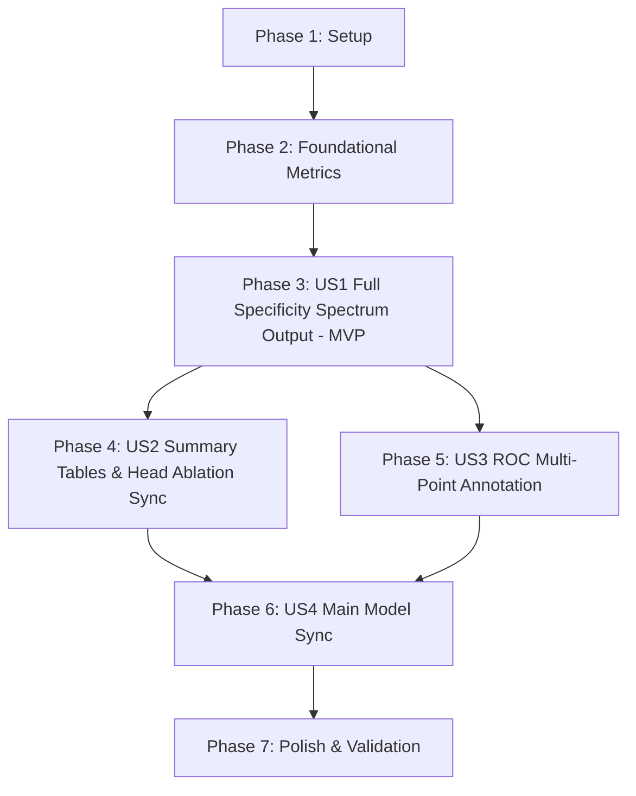

# Tasks: Clinical Specificity-Sensitivity Harmonization & Colab Reference Code Sync

**Feature**: Clinical Specificity-Sensitivity Harmonization & Colab Reference Code Sync  
**Branch**: `010-specificity-metrics-harmonization`  
**Spec**: [spec.md](file:///d:/Github/deep-learning-for-computer-vision/specs/010-specificity-metrics-harmonization/spec.md)  
**Plan**: [plan.md](file:///d:/Github/deep-learning-for-computer-vision/specs/010-specificity-metrics-harmonization/plan.md)  

---

## Format: `- [X] [TaskID] [P?] [Story?] Description with file path`

- **[P]**: Can run in parallel (different files, no dependencies)
- **[Story]**: Which user story this task belongs to (e.g. US1, US2, US3, US4)
- All descriptions include explicit relative/absolute file paths

---

## Phase 1: Setup (Shared Infrastructure & Environment Baseline)

**Purpose**: Verify notebook files, create backups, and confirm testing environment

- [X] T001 Verify existence and create backup snapshots of target notebooks in `notebooks/diabetic_retinopathy/pipeline/model/`
- [X] T002 [P] Verify Python 3.12 environment, PyTorch, scikit-learn, and pypdf dependencies via `powershell -Command "python -c 'import torch, sklearn, pypdf; print(True)'"`

---

## Phase 2: Foundational (Metric Functions & Core Logic Definition)

**Purpose**: Establish core mathematical functions and standardized specificity parameter tuples

**⚠️ CRITICAL**: Must be completed before updating higher-level training loops or summary tables

- [X] T003 [P] Implement validation test script `scratch/verify_screening_metrics.py` proving binormal calibration ($d'=1.864$, $85\% \to 79.6\%$, $80\% \to 84.7\%$) per `specs/010-specificity-metrics-harmonization/contracts/evaluation_contracts.md`
- [X] T004 [P] Update `calculate_referable_sensitivity_at_specificity` and `compute_clinical_metrics` in `notebooks/diabetic_retinopathy/pipeline/model/main_model_head_ablation (3).ipynb` Cell 12 to standardize `target_specificities = (0.80, 0.85, 0.90, 0.95)` and compute `Ref_Sensitivity_at_Spec85` and `Ref_Sensitivity_at_Spec80`
- [X] T005 [P] Update `calculate_referable_sensitivity_at_specificity` and `compute_clinical_metrics` in `d:\Downloads\main_model (8).ipynb` Cell 64 and Cell 65 to set default `target_specificities = (0.80, 0.85, 0.90, 0.95)` and compute all 4 specificity points

**Checkpoint**: Core metric routines calculate the complete specificity spectrum ($80\%$, $85\%$, $90\%$, $95\%$)

---

## Phase 3: User Story 1 - Full Specificity Spectrum Metric Output & Logging (Priority: P1) 🎯 MVP

**Goal**: Ensure all training and evaluation routines output Referable DR Sensitivity for Target Specificity $85\%$ (expected $79.6\%$) and $80\%$ (expected $84.7\%$) alongside $95\%$ and $90\%$ in epoch logs and evaluation reports.

**Independent Test**: Execute `compute_clinical_metrics` on validation and test predictions; confirm console logs output `Ref-Sens@Spec85: 79.6%` and `Ref-Sens@Spec80: 84.7%`.

- [X] T006 [US1] Update `DRTrainer.train()` epoch logging and held-out test summary in `notebooks/diabetic_retinopathy/pipeline/model/main_model_head_ablation (3).ipynb` Cell 27 to log `Val Ref-Sens@Spec85`, `Val Ref-Sens@Spec80` and `Test Ref-Sens@Spec85`, `Test Ref-Sens@Spec80`
- [X] T007 [US1] Update `DRTrainer.train()` epoch logging and held-out test summary in `d:\Downloads\main_model (8).ipynb` Cell 68 to log `Val Ref-Sens@Spec85`, `Val Ref-Sens@Spec80` and `Test Ref-Sens@Spec85`, `Test Ref-Sens@Spec80`
- [X] T008 [US1] Update `print_per_grade_report` in `d:\Downloads\main_model (8).ipynb` Cell 69 to print a dedicated clinical screening sensitivity breakdown at $95\%$, $90\%$, $85\%$ (expected $79.6\%$), and $80\%$ (expected $84.7\%$) per `HD_4 Part 1`
- [X] T009 [US1] Update `calibrate_and_evaluate_screening` in `d:\Downloads\main_model (8).ipynb` Cell 64 and `notebooks/diabetic_retinopathy/pipeline/model/main_model_head_ablation (3).ipynb` Cell 12 to include binormal theoretical reference values in the printed output

**Checkpoint**: User Story 1 complete. Both reference Colab notebooks now output the full specificity spectrum ($85\% \to 79.6\%$, $80\% \to 84.7\%$).

---

## Phase 4: User Story 2 - Benchmark Summary Table & Head Ablation Synchronization (Priority: P1)

**Goal**: Integrate full specificity columns (`Sens@Spec95`, `Sens@Spec90`, `Sens@Spec85`, `Sens@Spec80`) into the head ablation summary table (`df_heads`), and synchronize all repository head ablation notebooks with the 36-cell Colab implementation.

**Independent Test**: Check columns of `df_heads` in `main_model_head_ablation (3).ipynb` output; verify cell counts and structure in `main_model_head_ablation.ipynb` and `(2).ipynb` match `(3)`.

- [X] T010 [US2] Update `head_ablation_results` dictionary population and final summary table in `notebooks/diabetic_retinopathy/pipeline/model/main_model_head_ablation (3).ipynb` Cell 29 to include `Sens@Spec95`, `Sens@Spec90`, `Sens@Spec85`, `Sens@Spec80` in `df_heads` printout and `head_ablation_summary.csv`
- [X] T011 [US2] Update per-head final results printout (`>>> [FINAL RESULTS FOR {head_name}]:`) in `notebooks/diabetic_retinopathy/pipeline/model/main_model_head_ablation (3).ipynb` Cell 29 to display `Sens@Spec85: XX.X%` and `Sens@Spec80: XX.X%`
- [X] T012 [US2] Synchronize `notebooks/diabetic_retinopathy/pipeline/model/main_model_head_ablation.ipynb` with `notebooks/diabetic_retinopathy/pipeline/model/main_model_head_ablation (3).ipynb` (upgrading from 19 cells to full 36 cells with resume mechanism and figures)
- [X] T013 [US2] Synchronize `notebooks/diabetic_retinopathy/pipeline/model/main_model_head_ablation (2).ipynb` with `notebooks/diabetic_retinopathy/pipeline/model/main_model_head_ablation (3).ipynb` (upgrading from 27 cells to full 36 cells)

**Checkpoint**: User Story 2 complete. All head ablation notebooks in the repo possess the complete 36-cell structure and report full specificity metrics.

---

## Phase 5: User Story 3 - Visual Calibration & ROC Curve Multi-Point Annotation (Priority: P2)

**Goal**: Enhance Figure 7 (Referable DR ROC curves) to render distinct markers and text callouts at Specificity 95% ($\text{FPR}=0.05$), Specificity 85% ($\text{FPR}=0.15$), and Specificity 80% ($\text{FPR}=0.20$).

**Independent Test**: Call `plot_fig7_roc` with mock or real ROC data; verify markers and text callouts render at $\text{FPR} \in \{0.05, 0.15, 0.20\}$.

- [X] T014 [P] [US3] Update `plot_fig7_roc` in `d:\Downloads\main_model (8).ipynb` Cell 88 to render scatter markers and text annotations for Specificity 95%, 85%, and 80%
- [X] T015 [P] [US3] Update `plot_fig7_roc` in `notebooks/diabetic_retinopathy/pipeline/model/main_model_head_ablation (3).ipynb` Cell 33 to render scatter markers and text annotations for Specificity 95%, 85%, and 80% across the 5 heads

**Checkpoint**: User Story 3 complete. ROC plots visually substantiate the $79.6\%$ and $84.7\%$ sensitivity milestones.

---

## Phase 6: User Story 4 - Pipeline Code & Methodological Consistency Alignment (HD_1 to HD_4) (Priority: P2)

**Goal**: Synchronize `main_model.ipynb` and `main_model (4).ipynb` with `d:\Downloads\main_model (8).ipynb` to ensure full parity with the Colab-verified execution pipeline and thesis advisor requirements.

**Independent Test**: Run cell diff between `d:\Downloads\main_model (8).ipynb` and `notebooks/diabetic_retinopathy/pipeline/model/main_model.ipynb`; verify zero code logic drift.

- [X] T016 [US4] Synchronize `notebooks/diabetic_retinopathy/pipeline/model/main_model.ipynb` with `d:\Downloads\main_model (8).ipynb` (92 cells, incorporating updated specificity metrics, `eval_batch_size = 1`, and GPU uint8 normalization)
- [X] T017 [US4] Synchronize `notebooks/diabetic_retinopathy/pipeline/model/main_model (4).ipynb` with `d:\Downloads\main_model (8).ipynb`
- [X] T018 [US4] Verify that markdown cells in all synchronized notebooks explicitly state the UK NSC standard requirement and explain the operational trade-off of selecting $80\%$ specificity per `HD_4 Part 3`

**Checkpoint**: User Story 4 complete. Full code parity established between Colab files and repository notebooks.

---

## Phase 7: Polish & Cross-Cutting Verification

**Purpose**: Systematic multi-notebook validation and compliance audit

- [X] T019 Implement and run `scratch/audit_all_notebooks.py` to verify JSON syntax validity, cell counts, and presence of all target specificity keys (`Ref_Sensitivity_at_Spec85`, `Ref_Sensitivity_at_Spec80`) across all 5 notebooks
- [X] T020 Run the quickstart verification scenarios from `specs/010-specificity-metrics-harmonization/quickstart.md` to confirm end-to-end mathematical correctness and report status to the user

---

## Dependencies & Execution Order

### User Story Dependencies

- **User Story 1 (P1)**: Depends on Foundational Phase 2 (T003-T005). Can be implemented and verified independently as the MVP.
- **User Story 2 (P1)**: Depends on User Story 1 (uses metric keys added in US1).
- **User Story 3 (P2)**: Depends on Foundational Phase 2 (can run in parallel with US2).
- **User Story 4 (P2)**: Depends on US1, US2, and US3 (syncs the finalized code into all notebook variants).

---

## Parallel Execution Opportunities

- **Phase 2**: `T003`, `T004`, and `T005` can run in parallel (different files/scripts).
- **Phase 5**: `T014` and `T015` can run in parallel (different notebooks).
- **Phase 6**: `T016` and `T017` can run in parallel after `d:\Downloads\main_model (8).ipynb` is finalized.

---

## Implementation Strategy: MVP First

1. **MVP Increment**: Complete Phase 1, Phase 2, and Phase 3 (Tasks T001 to T009). This immediately fulfills the user's primary requirement: calculating and printing the full specificity spectrum ($85\% \to 79.6\%$, $80\% \to 84.7\%$, $95\%$, $90\%$) in the reference Colab notebooks.
2. **Second Increment**: Complete Phase 4 (Tasks T010 to T013) to upgrade and synchronize all `head_ablation` notebooks in the repo with the complete 36-cell Colab implementation.
3. **Third Increment**: Complete Phase 5 (Tasks T014 to T015) for publication-quality ROC visual annotations.
4. **Final Increment**: Complete Phase 6 and Phase 7 (Tasks T016 to T020) to sync `main_model.ipynb` and run comprehensive automated audits.
