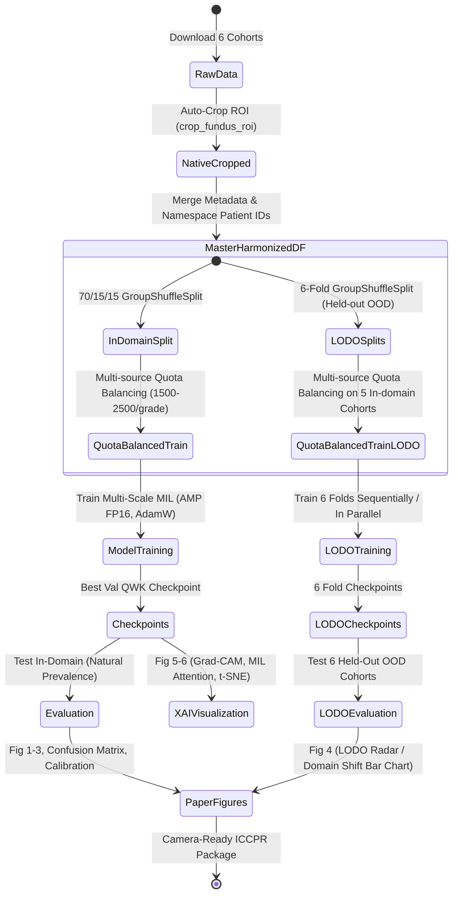

# Data Model & Entity Specifications: Official ICCPR Repository

**Feature**: [spec.md](file:///d:/Github/deep-learning-for-computer-vision/specs/015-official-repo-structure/spec.md) | **Date**: 2026-09-19  
**Paper**: *Deconstructing Domain Shift in Diabetic Retinopathy Grading: Multi-Scale MIL with Consistent Ordinal Regression* (ICCPR Conference)

---

## 1. Core Entities & Data Structures

### 1.1 `CohortDataset`
Represents a source multi-center clinical fundus cohort before harmonization.

| Field | Type | Description | Validation Rules |
|---|---|---|---|
| `key` | `str` | Short uppercase identifier (`APTOS`, `DDR`, `DeepDRiD`, `IDRiD`, `Messidor-2`, `EyePACS`) | Must be one of the 6 supported keys |
| `name` | `str` | Human-readable name (e.g., `APTOS 2019`) | Non-empty |
| `csv_path` | `str` | Relative path to raw annotation CSV | Must exist on disk |
| `img_dir` | `str` | Relative path to raw image directory | Must exist on disk |
| `id_col` | `str` | Column name containing image identifier | Must exist in raw CSV |
| `label_col` | `str` | Column name containing DR severity level | Must exist in raw CSV |
| `id_suffix` | `str` | Image file extension (`.png`, `.jpg`, `.jpeg`) | Non-empty |

---

### 1.2 `FundusRecord`
Standardized tabular record representing a single retinal fundus image in the master pool.

| Field | Type | Description | Validation Rules |
|---|---|---|---|
| `image_id` | `str` | Original image identifier from dataset | Non-empty |
| `diagnosis` | `int` | Standardized ICDRS DR severity grade (0 to 4) | Strictly $\in \{0, 1, 2, 3, 4\}$ |
| `dataset_key` | `str` | Source dataset identifier | Must match `CohortDataset.key` |
| `dataset_name` | `str` | Source dataset full name | Non-empty |
| `patient_id` | `str` | Namespaced patient identifier (`{dataset_key}::{pid}`) | Guarantees zero cross-cohort collision |
| `side` | `str` | Eye orientation (`left`, `right`, `unknown`) | Must be one of `left`, `right`, `unknown` |
| `raw_full_path` | `str` | Absolute path to raw un-cropped image | Optional after native cropping |
| `relative_path`| `str` | Relative path within `native_cropped/` (`{dataset_key}/{image_id}.jpg`) | Image must physically exist on disk |
| `native_path` | `str` | Full or relative path to ROI-cropped native image | Image must be loadable via `cv2.imread` |

---

### 1.3 `SplitDataset` & `LODOFold`
Defines patient-level partitioned subsets for in-domain experiments or LODO benchmarks.

| Field | Type | Description | Invariants & Constraints |
|---|---|---|---|
| `split_type` | `str` | `'in_domain'` or `'lodo'` | Must be one of `in_domain`, `lodo` |
| `fold_idx` | `Optional[int]`| Fold index (0 to 5) for LODO; `None` for in-domain | $0 \le \text{fold\_idx} \le 5$ if LODO |
| `held_out_key` | `Optional[str]`| Dataset key held out for OOD testing (LODO only) | E.g., `'APTOS'` for fold 0 |
| `train_df` | `DataFrame` | Balanced training pool (1,500 - 2,500 images/grade) | Zero patient overlap with `val_df` & `test_df` |
| `val_df` | `DataFrame` | In-domain validation pool at natural clinical prevalence | Zero patient overlap with `train_df` & `test_df` |
| `test_df` | `DataFrame` | Test pool (in-domain or 100% held-out OOD cohort) | Zero patient overlap with `train_df` & `val_df` |

---

### 1.4 `MultiScaleMILModel`
PyTorch neural network entity combining dual-stream feature extraction, attention MIL, and consistent ordinal head.

```text
Input: Whole-Fundus Image (512x512x3) + K High-Res Patches (K x 224x224x3)
  ├── Global Branch (EfficientNet-B0) ──> Global Feature Vector (d_g)
  ├── Local Patch Branch (Shared Backbone) ──> K Patch Vectors (K x d_l)
  │     └── Attention MIL Pooling Module (MSAG/CBAM) ──> Aggregated Patch Vector (d_l)
  └── Fusion Layer (Concatenation / Linear Projection) ──> Unified Representation (d_f)
        └── Consistent Ordinal Prediction Head ──> 4 Monotonic Cumulative Logits
```

---

### 1.5 `ClinicalMetrics`
Standardized evaluation metrics dictionary for reporting performance and domain shift.

| Metric | Code Key | Formula / Description | Clinical Meaning |
|---|---|---|---|
| **Quadratic Weighted Kappa** | `qwk` | Cohen's Kappa with quadratic penalty weights | Primary competition & research metric; penalizes severe misclassifications |
| **Cohen's Kappa** | `kappa` | Standard linear unweighted Cohen's Kappa | Inter-rater agreement beyond chance |
| **Macro AUC-ROC** | `macro_auc` | One-vs-Rest AUC-ROC averaged unweighted across 5 classes | Discrimination capability across all grades |
| **Referable Sensitivity** | `sens_referable` | True Positive Rate for DR Grade $\ge 2$ | Screening safety: ensuring patients needing treatment are not missed |
| **Referable Specificity** | `spec_referable` | True Negative Rate for DR Grade $< 2$ | Screening efficiency: minimizing unnecessary hospital referrals |
| **Expected Calibration Error** | `ece` | Bin-weighted difference between confidence and accuracy | Reliability of predicted model probabilities |
| **Domain Shift Drop** | `domain_gap` | $QWK_{\text{in-domain}} - QWK_{\text{OOD}}$ | Performance degradation under real-world camera/center shift |

---

## 2. State Transitions & Lifecycle


