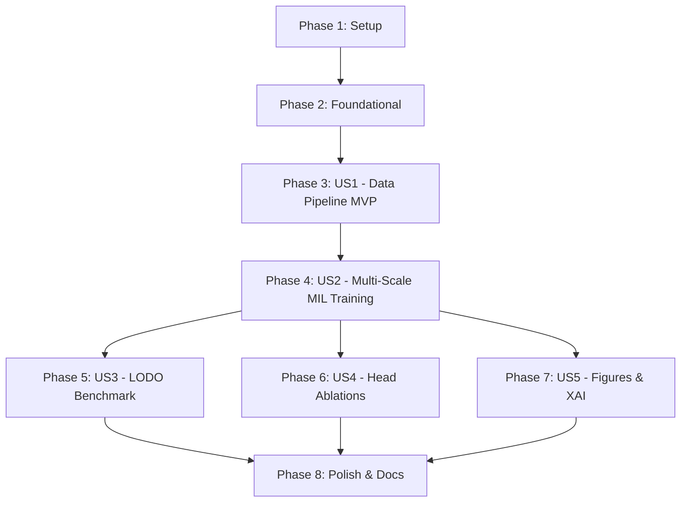

# Tasks: Official Repository Architecture & End-to-End Pipeline for ICCPR Paper

**Input**: Design documents from `specs/015-official-repo-structure/` (`spec.md`, `plan.md`, `research.md`, `data-model.md`, `contracts/`, `quickstart.md`)  
**Paper Title**: *Deconstructing Domain Shift in Diabetic Retinopathy Grading: Multi-Scale MIL with Consistent Ordinal Regression* (ICCPR Conference)  
**Prerequisites**: `plan.md` (completed), `spec.md` (completed), `research.md` (completed), `data-model.md` (completed), `contracts/` (completed)

---

## Format: `- [ ] [ID] [P?] [Story] Description with file path`
- **[P]**: Can run in parallel (different files, no dependencies)
- **[Story]**: Which user story this task belongs to ([US1], [US2], [US3], [US4], [US5])
- All tasks reference explicit, concrete file paths.

---

## Phase 1: Setup (Shared Infrastructure)

**Purpose**: Project initialization, directory tree setup, and packaging configuration.

- [X] T001 Create official directory structure (`configs/`, `src/dr_multiscale_mil/`, `scripts/`, `notebooks/`, `checkpoints/`, `results/`, `docs/`) per implementation plan
- [X] T002 [P] Create package setup file `pyproject.toml` and `setup.py` at repository root for editable installation (`pip install -e .`)
- [X] T003 [P] Create base package initialization file `src/dr_multiscale_mil/__init__.py` with package metadata and version `0.1.0`

---

## Phase 2: Foundational (Blocking Prerequisites)

**Purpose**: Core configuration schemas, environment resolvers, and logging infrastructure that MUST be complete before ANY user story can proceed.

**⚠️ CRITICAL**: No user story work can begin until this phase is complete.

- [X] T004 Create dataset and LODO fold configurations in `configs/data/datasets.yaml` and `configs/data/lodo_folds.yaml`
- [X] T005 [P] Create champion training and LODO benchmark configurations in `configs/train/in_domain.yaml` and `configs/train/lodo_benchmark.yaml`
- [X] T006 [P] Implement dynamic environment detection (Google Colab vs Local Workstation, Drive mounting, CUDA/MPS/CPU detection) in `src/dr_multiscale_mil/utils/env.py`
- [X] T007 Implement deterministic seed initialization (`SEED=42`) and logging infrastructure in `src/dr_multiscale_mil/utils/logger.py`

**Checkpoint**: Foundation ready - user story implementation can now begin.

---

## Phase 3: User Story 1 - Reproducible Data Pipeline & Harmonization (Priority: P1) 🎯 MVP

**Goal**: Establish a unified, zero-leakage pipeline to preprocess, harmonize, and split all 6 raw fundus cohorts (APTOS, DDR, DeepDRiD, IDRiD, Messidor-2, EyePACS).

**Independent Test**: Execute `scripts/01_preprocess_data.sh` and `scripts/02_make_splits.sh`, verifying that images are saved to `data/raw/hybrid/native_cropped/`, 18 LODO CSVs exist in `data/processed/lodo_folds/`, and zero patient leakage assertions pass.

### Implementation for User Story 1

- [X] T008 [P] [US1] Migrate circular fundus ROI auto-cropping logic from `pipeline/full/preprocessing.py` and `notebooks/diabetic_retinopathy/pipeline/merge-dataset/merge-dataset.ipynb` into `src/dr_multiscale_mil/data/roi_crop.py`
- [X] T009 [P] [US1] Migrate dataset schema harmonization, ICDRS grade cleaning (0-4), and patient ID namespacing (`dataset_key::patient_id`) from `merge-dataset.ipynb` into `src/dr_multiscale_mil/data/harmonization.py`
- [X] T010 [US1] Migrate multi-source quota-balanced sampling (1,500 - 2,500/grade) and 70/15/15 + 6-fold LODO split generators from `merge_dataset_lodo.ipynb` and `scratch/generate_lodo_splits.py` into `src/dr_multiscale_mil/data/split_generator.py`
- [X] T011 [P] [US1] Migrate Albumentations transformation pipelines for Global stream (512x512) and Local Patch stream (224x224) from `scratch/extracted_defs_from_main_model.py` into `src/dr_multiscale_mil/data/augmentations.py`
- [X] T012 [US1] Migrate PyTorch `FundusDataset` and thread-safe DataLoader from `pipeline/full/data_loader.py` into `src/dr_multiscale_mil/data/dataset.py`
- [X] T013 [US1] Implement CLI entry points `src/dr_multiscale_mil/data/preprocess.py` and `src/dr_multiscale_mil/data/make_splits.py`
- [X] T014 [US1] Create runner shell scripts `scripts/01_preprocess_data.sh` and `scripts/02_make_splits.sh`

**Checkpoint**: User Story 1 is fully functional and independently testable as an MVP increment.

---

## Phase 4: User Story 2 - Modular Multi-Scale MIL Architecture & Training (Priority: P1)

**Goal**: Instantiate, configure, and train the champion Multi-Scale MIL with Consistent Ordinal Regression network on the in-domain benchmark.

**Independent Test**: Run `scripts/03_train_in_domain.sh` for 1 epoch or dry-run, verifying forward/backward pass, Consistent Ordinal Loss computation, QWK tracking, and checkpoint saving to `checkpoints/checkpoints_main/best_model_qwk.pt`.

### Implementation for User Story 2

- [X] T015 [P] [US2] Migrate CNN backbones (EfficientNet-B0/B3, DenseNet-121, ResNet-50) from `pipeline/full/models.py` into `src/dr_multiscale_mil/models/backbones.py`
- [X] T016 [P] [US2] Migrate CBAM (Channel & Spatial Attention) from `scratch/extracted_defs_from_main_model.py` and MSAG from `src/attention/msag.py` into `src/dr_multiscale_mil/models/attention.py`
- [X] T017 [P] [US2] Migrate Multi-Scale Attention MIL Pooling module from `pipeline/full/models.py` into `src/dr_multiscale_mil/models/mil_pooling.py`
- [X] T018 [P] [US2] Migrate Consistent Ordinal Head, CORAL head, and Softmax head from `pipeline/full/losses_and_heads.py` into `src/dr_multiscale_mil/models/heads.py`
- [X] T019 [US2] Migrate dual-stream `MultiScaleMILNet` combining Global branch + Local Patch branch + Attention MIL + Prediction Head from `pipeline/full/models.py` into `src/dr_multiscale_mil/models/multiscale_mil_net.py`
- [X] T020 [P] [US2] Migrate Consistent Ordinal Loss, CORAL loss, and Soft-QWK loss from `pipeline/full/losses_and_heads.py` into `src/dr_multiscale_mil/losses/ordinal_loss.py` and `src/dr_multiscale_mil/losses/qwk_loss.py`
- [X] T021 [US2] Migrate training loop, AMP FP16 engine, CosineAnnealing scheduler, and QWK early stopping from `pipeline/full/trainer.py` into `src/dr_multiscale_mil/training/trainer.py`
- [X] T022 [P] [US2] Migrate clinical evaluation metrics (QWK, Cohen's Kappa, Macro AUC, Referable Sensitivity & Specificity for Grade $\ge 2$, ECE) from `scratch/verify_screening_metrics.py` into `src/dr_multiscale_mil/evaluation/metrics.py`
- [X] T023 [US2] Implement CLI training entry point `src/dr_multiscale_mil/train.py` and runner shell script `scripts/03_train_in_domain.sh`

**Checkpoint**: User Stories 1 AND 2 are both functional; in-domain model can be trained end-to-end.

---

## Phase 5: User Story 3 - 6-Fold Leave-One-Dataset-Out (LODO) Generalization Benchmark (Priority: P2)

**Goal**: Execute the full 6-fold LODO cross-validation across all 6 cohorts to systematically evaluate out-of-distribution generalization.

**Independent Test**: Run `scripts/04_run_lodo_benchmark.sh --fold 0` (or all folds), verifying that each fold trains on 5 cohorts and evaluates on the held-out 6th cohort, exporting `results/tables/lodo_benchmark_results.csv`.

### Implementation for User Story 3

- [X] T024 [US3] Implement LODO fold execution loop and held-out OOD evaluation logic in `src/dr_multiscale_mil/training/lodo_trainer.py`
- [X] T025 [P] [US3] Implement domain shift degradation quantification ($QWK_{\text{in-domain}} - QWK_{\text{OOD}}$) in `src/dr_multiscale_mil/evaluation/domain_shift.py`
- [X] T026 [US3] Implement CLI entry point `src/dr_multiscale_mil/train_lodo.py` and runner shell script `scripts/04_run_lodo_benchmark.sh`
- [X] T027 [US3] Implement standalone evaluation script in `src/dr_multiscale_mil/evaluate.py` exporting aggregated results to `results/tables/lodo_benchmark_results.csv`

**Checkpoint**: User Story 3 complete; 6-fold LODO benchmark can be executed and evaluated.

---

## Phase 6: User Story 4 - Head & Architectural Ablation Suite (Priority: P2)

**Goal**: Reproduce the ablation studies comparing prediction heads (Nominal Softmax, CORAL, Consistent Ordinal, Regression) and preprocessing modes.

**Independent Test**: Execute `scripts/05_run_head_ablation.sh`, verifying that metrics across all 4 prediction heads are computed and saved to `results/tables/head_ablation_summary.csv`.

### Implementation for User Story 4

- [X] T028 [P] [US4] Create YAML ablation configurations in `configs/ablations/head_ablation.yaml` and `configs/ablations/preprocessing_ablation.yaml`
- [X] T029 [US4] Implement ablation training runner in `src/dr_multiscale_mil/train_ablation.py` supporting head switching and preprocessing ablation flags
- [X] T030 [US4] Create runner shell script `scripts/05_run_head_ablation.sh` and metric aggregator exporting `results/tables/head_ablation_summary.csv`

**Checkpoint**: User Story 4 complete; ablation tables reported in the paper can be generated.

---

## Phase 7: User Story 5 - Publication Figures & Explainable AI (XAI) Generation (Priority: P3)

**Goal**: Generate all 6 camera-ready figures (Dual-stream architecture, cohort distribution, calibration curves, LODO radar, Grad-CAM/MIL attention heatmaps, and t-SNE embeddings) matching ICCPR standards (300 DPI PNG + vector PDF).

**Independent Test**: Run `scripts/06_generate_figures.sh`, verifying that 6 publication figures exist in `results/figures/` in both PDF and 300 DPI PNG formats.

### Implementation for User Story 5

- [X] T031 [P] [US5] Migrate Grad-CAM for Global stream and MIL patch attention heatmaps from `visualize_main_model.py` into `src/dr_multiscale_mil/visualization/gradcam.py` and `src/dr_multiscale_mil/visualization/mil_attention_map.py`
- [X] T032 [P] [US5] Implement t-SNE / UMAP feature embedding visualization in `src/dr_multiscale_mil/visualization/embeddings.py` showing domain alignment
- [X] T033 [US5] Migrate Figure 1-6 publication rendering code from `visualize_main_model.py` into `src/dr_multiscale_mil/visualization/paper_figures.py`
- [X] T034 [US5] Implement CLI entry point `src/dr_multiscale_mil/visualize.py` and runner shell script `scripts/06_generate_figures.sh`

**Checkpoint**: User Story 5 complete; all publication figures and interpretability maps generated.

---

## Phase 8: Polish, Notebooks & Documentation

**Purpose**: Provide self-contained Google Colab notebooks, reproduction documentation, and final repository packaging.

- [X] T035 [P] Create self-contained Google Colab demonstration notebooks in `notebooks/`:
  - `notebooks/01_data_harmonization_and_lodo.ipynb`
  - `notebooks/02_train_main_model.ipynb`
  - `notebooks/03_head_ablation_analysis.ipynb`
  - `notebooks/04_lodo_generalization_eval.ipynb`
  - `notebooks/05_xai_and_publication_figures.ipynb`
- [X] T036 [P] Create detailed guides in `docs/dataset_setup.md`, `docs/reproduce_experiments.md`, and `docs/colab_guide.md`
- [X] T037 Create official `README.md` at repository root with paper abstract, architecture diagram, benchmark leaderboard, installation, and BibTeX citation
- [X] T038 Execute quickstart validation scenarios from `specs/015-official-repo-structure/quickstart.md` to confirm end-to-end reproducibility

---

## Dependencies & Execution Order

### Phase Dependencies

### User Story Dependencies

- **User Story 1 (P1)**: Depends on Foundational (Phase 2). Delivers standalone data preparation and LODO splits.
- **User Story 2 (P1)**: Depends on US1 (requires datasets/splits). Delivers in-domain champion model training.
- **User Story 3 (P2)**: Depends on US1 & US2. Delivers 6-Fold LODO cross-validation.
- **User Story 4 (P2)**: Depends on US1 & US2. Delivers head and preprocessing ablations.
- **User Story 5 (P3)**: Depends on US2 (requires trained checkpoint). Delivers publication figures and XAI maps.

---

## Parallel Opportunities

- **Phase 1 & 2**: T002, T003, T005, T006 can execute in parallel.
- **Phase 3 (US1)**: T008 (ROI crop), T009 (harmonization), and T011 (augmentations) can execute in parallel.
- **Phase 4 (US2)**: T015 (backbones), T016 (attention), T017 (MIL pooling), T018 (heads), T020 (losses), and T022 (metrics) can execute in parallel.
- **Phase 5, 6, 7**: Once US2 is complete, US3 (LODO), US4 (Ablations), and US5 (Figures) can proceed independently in parallel.
- **Phase 8**: T035 (notebooks) and T036 (docs) can execute in parallel.

---

## Implementation Strategy

### MVP First (User Story 1 & 2)
1. Complete Phase 1 (Setup) and Phase 2 (Foundational).
2. Complete Phase 3 (US1: Preprocessing & Splits) -> Validate data pipeline independently.
3. Complete Phase 4 (US2: Multi-Scale MIL Model) -> Train in-domain model and verify QWK score.
4. **MVP Milestone Achieved**: Core scientific method is fully functional, modular, and verifiable.

### Full Research Benchmark & Publication Package
5. Execute Phase 5 (US3: 6-Fold LODO) -> Export domain shift benchmark tables.
6. Execute Phase 6 (US4: Head Ablations) -> Export ablation comparison tables.
7. Execute Phase 7 (US5: Figures & XAI) -> Render camera-ready Figures 1 to 6.
8. Execute Phase 8 (Polish, Colab Notebooks & Documentation) -> Ready for ICCPR conference submission.
