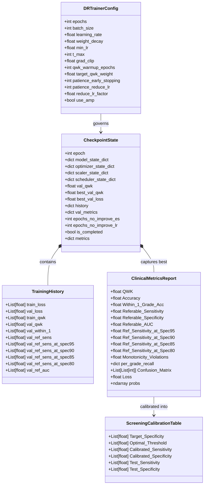
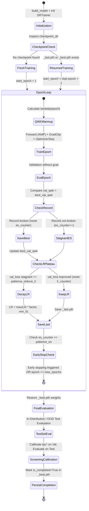

# Data Model: Training Engine & Evaluation Artifacts

**Feature**: `019-sync-notebook-training-pipelines`  
**Date**: 2026-09-24  
**Status**: Completed  

---

## 1. Core Entities

---

## 2. Entity Descriptions & Field Specifications

### 2.1. `DRTrainerConfig`
Represents the unified hyperparameter configuration governing model optimization across notebooks.

| Field Name | Type | Range / Default | Description |
| :--- | :--- | :--- | :--- |
| `epochs` | `int` | $25 - 100$ | Total epochs scheduled for training |
| `batch_size` | `int` | $8 - 48$ | Mini-batch size (e.g. 16 for Dual-Branch, 48 for Head Ablation) |
| `learning_rate` | `float` | $1.0 \times 10^{-4}$ | Initial learning rate for AdamW optimizer |
| `weight_decay` | `float` | $1.0 \times 10^{-4} - 1.0 \times 10^{-3}$ | Decoupled weight decay parameter |
| `min_lr` | `float` | $1.0 \times 10^{-6}$ | Minimum learning rate lower bound for scheduler and decay |
| `t_max` | `int` | $25 - 50$ | Cosine cycle duration for `CosineAnnealingLR` |
| `grad_clip` | `float` | $1.0$ | Norm ceiling for gradient clipping (`clip_grad_norm_`) |
| `qwk_warmup_epochs`| `int` | $15$ | Number of epochs over which QWK loss weight $\lambda$ warms up linearly |
| `target_qwk_weight`| `float` | $0.4$ | Maximum asymptotic weight $\lambda_{\text{target}}$ for Continuous QWK Loss |
| `patience_early_stopping` | `int` | $15$ | Number of epochs without `val_qwk` improvement before early termination |
| `patience_reduce_lr` | `int` | $4$ | Number of epochs without `val_loss` improvement before 50% LR decay |
| `reduce_lr_factor` | `float` | $0.5$ | Multiplicative factor for learning rate plateau reduction |
| `use_amp` | `bool` | `True` | Enable automatic mixed precision (`bfloat16` or `float16`) |

---

### 2.2. `CheckpointState`
Represents the complete serialized state dictionary written to `_best.pth` and `_last.pth`.

| Field Name | Type | Required | Description |
| :--- | :--- | :--- | :--- |
| `epoch` | `int` | Yes | 1-indexed epoch number at save time |
| `model_state_dict` | `dict` | Yes | Complete neural network module state dictionary |
| `optimizer_state_dict` | `dict` | Yes | PyTorch AdamW optimizer state dictionary |
| `scaler_state_dict` | `dict / None` | Conditional | GradScaler state dictionary (present when FP16 AMP is enabled) |
| `scheduler_state_dict`| `dict / None` | Conditional | CosineAnnealingLR or plateau scheduler state dictionary |
| `val_qwk` | `float` | Yes | Validation Quadratic Weighted Kappa at current epoch |
| `best_val_qwk` | `float` | Yes | Historical best Validation QWK observed up to current epoch |
| `best_val_loss` | `float` | Yes | Historical best Validation Loss observed up to current epoch |
| `history` | `dict` | Yes | Serialized `TrainingHistory` tracking epoch metrics |
| `val_metrics` | `dict` | Yes | Full `ClinicalMetricsReport` for the validation set |
| `epochs_no_improve_es` | `int` | Yes | Decoupled early stopping stagnation counter (tracked on `val_qwk`) |
| `epochs_no_improve_lr` | `int` | Yes | Decoupled learning rate reduction counter (tracked on `val_loss`) |
| `is_completed` | `bool` | Optional | Completion flag marking that the fold/run completed all epochs/evaluation |
| `metrics` | `dict` | Optional | Final consolidated evaluation metrics recorded upon completion |

---

### 2.3. `TrainingHistory`
Maintains epoch-by-epoch historical metric arrays for diagnostic and publication visualization.

- `train_loss`: `List[float]`
- `val_loss`: `List[float]`
- `train_qwk`: `List[float]`
- `val_qwk`: `List[float]`
- `val_within_1`: `List[float]`
- `val_ref_sens`: `List[float]`
- `val_ref_sens_at_spec95`: `List[float]`
- `val_ref_sens_at_spec90`: `List[float]`
- `val_ref_sens_at_spec85`: `List[float]`
- `val_ref_sens_at_spec80`: `List[float]`
- `val_ref_auc`: `List[float]`

---

## 3. State Transitions & Lifecycle

