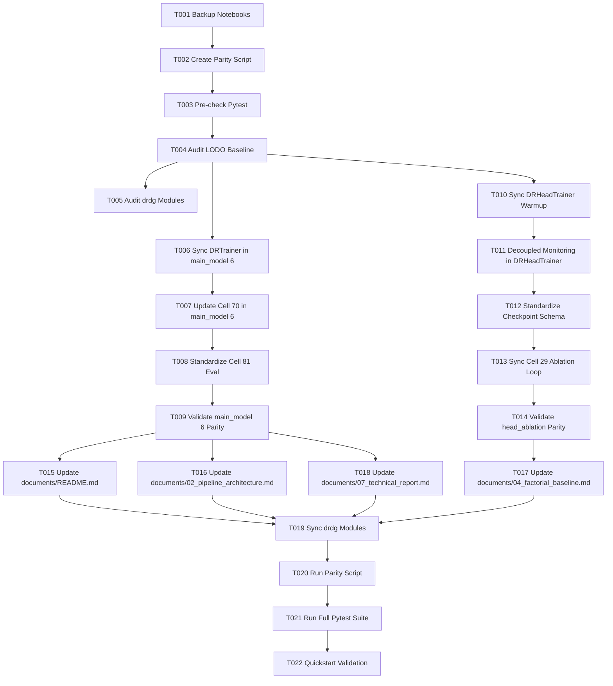

# Tasks: 019-sync-notebook-training-pipelines

**Input**: Design documents from `specs/019-sync-notebook-training-pipelines/`  
**Prerequisites**: [plan.md](file:///d:/Github/deep-learning-for-computer-vision/specs/019-sync-notebook-training-pipelines/plan.md), [spec.md](file:///d:/Github/deep-learning-for-computer-vision/specs/019-sync-notebook-training-pipelines/spec.md), [research.md](file:///d:/Github/deep-learning-for-computer-vision/specs/019-sync-notebook-training-pipelines/research.md), [data-model.md](file:///d:/Github/deep-learning-for-computer-vision/specs/019-sync-notebook-training-pipelines/data-model.md), [contracts/](file:///d:/Github/deep-learning-for-computer-vision/specs/019-sync-notebook-training-pipelines/contracts/)

## Format: `- [ ] [TaskID] [P?] [Story?] Description with file path`

- **[P]**: Can run in parallel (different files, no dependencies)
- **[Story]**: Which user story this task belongs to (`[US1]`, `[US2]`, `[US3]`)
- Clear and explicit file paths in every task description

---

## Phase 1: Setup & Pre-Flight Checks

**Purpose**: Safeguard existing code and prepare automated parity auditing tools

- [x] T001 Create backup copies of target notebooks in `scratch/backups/` before applying any modifications
- [x] T002 Create automated AST and cell-level parity verification script in `scratch/verify_notebook_training_parity.py`
- [x] T003 [P] Verify pre-modification baseline test suite status by running `pytest tests/`

---

## Phase 2: Foundational Training Infrastructure & Parity Grounding

**Purpose**: Confirm canonical training baseline and modular interface grounding

**⚠️ CRITICAL**: Establishes the authoritative reference parameters from `main_model_lodo.ipynb` before updating target notebooks

- [x] T004 Audit canonical `DRTrainer` definition in Cell 22 and execution in Cell 25 of `notebooks/diabetic_retinopathy/pipeline/model/main_model_lodo.ipynb` to catalog baseline parameters
- [x] T005 [P] Audit modular training classes in `src/drdg/training/trainer.py` and `src/drdg/training/head_trainer.py` for parity alignment targets

---

## Phase 3: User Story 1 - Full Architecture Notebook Training Synchronization (`main_model (6).ipynb`) (Priority: P1) 🎯 MVP

**Goal**: Harmonize `DRTrainer` and training execution in `main_model (6).ipynb` to strictly replicate the golden standard in `main_model_lodo.ipynb`.

**Independent Test**: Execute syntax and dry-run inspection on `main_model (6).ipynb` verifying that `DRTrainer` uses `self.lr_scheduler.step(val_qwk)`, Cell 70 passes all hyperparameters, and checkpoint schemas match `contracts/checkpoint_schema.json`.

- [x] T006 [US1] Synchronize `DRTrainer` class in Cell 68 of `notebooks/diabetic_retinopathy/pipeline/model/main_model (6).ipynb` to step external plateau schedulers on `val_qwk` and ensure complete checkpoint dictionary parity
- [x] T007 [US1] Update training execution Cell 70 of `notebooks/diabetic_retinopathy/pipeline/model/main_model (6).ipynb` to pass all parameters (`epochs=EPOCHS`, `model_name=model_tag`, `patience_early_stopping=PATIENCE_EARLY_STOPPING`, `patience_reduce_lr=PATIENCE_REDUCE_LR`, `reduce_lr_factor=REDUCE_LR_FACTOR`, `min_lr=MIN_LR`, `resume_checkpoint_path=resume_ckpt_path`)
- [x] T008 [US1] Standardize held-out test evaluation and checkpoint completion marking (`is_completed = True`) in Cell 81 of `notebooks/diabetic_retinopathy/pipeline/model/main_model (6).ipynb`
- [x] T009 [US1] Validate JSON structure, notebook cell execution integrity, and training parameter parity of `notebooks/diabetic_retinopathy/pipeline/model/main_model (6).ipynb` using `scratch/verify_notebook_training_parity.py`

**Checkpoint**: `main_model (6).ipynb` training mechanism is 100% synchronized with `main_model_lodo.ipynb`.

---

## Phase 4: User Story 2 - Head Ablation Benchmark Training Alignment (`main_model_head_ablation (3).ipynb`) (Priority: P2)

**Goal**: Align `DRHeadTrainer` and the 5-round ablation loop in `main_model_head_ablation (3).ipynb` with `DRTrainer`'s optimization and monitoring regimes.

**Independent Test**: Run validation checks verifying that `DRHeadTrainer` applies epoch-level QWK loss warmup, decoupled dual monitoring, unified evaluation return signatures, and full checkpoint restoration.

- [x] T010 [US2] Update `DRHeadTrainer.train_epoch` in Cell 27 of `notebooks/diabetic_retinopathy/pipeline/model/main_model_head_ablation (3).ipynb` to use epoch-level linear QWK loss warmup matching `DRTrainer`
- [x] T011 [US2] Enforce decoupled dual monitoring in `DRHeadTrainer.fit` in Cell 27 of `notebooks/diabetic_retinopathy/pipeline/model/main_model_head_ablation (3).ipynb` (saving `_best.pth` and early stopping on `val_qwk`, while reducing LR on `val_loss`)
- [x] T012 [US2] Standardize checkpoint state dictionary payload in Cell 27 of `notebooks/diabetic_retinopathy/pipeline/model/main_model_head_ablation (3).ipynb` to match `contracts/checkpoint_schema.json`
- [x] T013 [US2] Synchronize 5-round benchmark orchestration loop in Cell 29 of `notebooks/diabetic_retinopathy/pipeline/model/main_model_head_ablation (3).ipynb` to pass standardized training parameters, preserve GPU memory cleanup, and record `is_completed=True`
- [x] T014 [US2] Validate JSON structure, cell syntax, and training parity of `notebooks/diabetic_retinopathy/pipeline/model/main_model_head_ablation (3).ipynb` using `scratch/verify_notebook_training_parity.py`

**Checkpoint**: Both `main_model (6).ipynb` and `main_model_head_ablation (3).ipynb` share identical optimization dynamics and checkpoint schemas.

---

## Phase 5: User Story 3 - Master Technical Documentation Suite Synchronization (`documents/`) (Priority: P3)

**Goal**: Ensure all technical reports and repository monographs under `documents/` accurately reflect the synchronized codebase, active notebooks, and hyperparameter tables.

**Independent Test**: Inspect all four monographs under `documents/` to confirm that all references to model files, hyperparameters, training equations, and pipeline stages match the active notebooks.

- [x] T015 [P] [US3] Update Source Code Directory Map and monograph listings in `documents/README.md` to reference `main_model (6).ipynb`, `main_model_head_ablation (3).ipynb`, and `main_model_lodo.ipynb`
- [x] T016 [P] [US3] Update Section 4 and Section 5 in `documents/02_pipeline_architecture.md` to document decoupled dual monitoring, dynamic QWK loss warmup, bfloat16/float16 AMP detection, and post-hoc screening calibration
- [x] T017 [P] [US3] Update Head Ablation protocol and LODO cross-domain generalization descriptions in `documents/04_factorial_baseline_and_domain_shift_framework.md`
- [x] T018 [P] [US3] Synchronize Table 2.1 (Hyperparameters & Training Dynamics) and training control equations in `documents/07_technical_report_and_experimental_appendix.md` with active codebase values

**Checkpoint**: All documentation monographs under `documents/` are 100% synchronized with the active code implementation.

---

## Phase 6: Polish, Verification & Parity Assurance

**Purpose**: Guarantee modular library parity, run regression test suites, and execute quickstart validations

- [x] T019 [P] Synchronize modular library engines in `src/drdg/training/trainer.py` and `src/drdg/training/head_trainer.py` to maintain exact logic parity with the synchronized notebooks
- [x] T020 Run automated notebook verification script `scratch/verify_notebook_training_parity.py` across all three notebooks to confirm zero errors and 100% parity
- [x] T021 Execute full regression test suite via `pytest tests/` to verify zero regression across existing unit and integration tests
- [x] T022 Execute end-to-end quickstart validation checks defined in `specs/019-sync-notebook-training-pipelines/quickstart.md`

---

## Dependencies & Execution Sequence

---

## Parallel Execution Opportunities

- **Setup & Baseline Checks**: T002 and T003 can execute in parallel.
- **User Story 1 vs User Story 2**: Phase 3 (US1: `main_model (6).ipynb`) and Phase 4 (US2: `main_model_head_ablation (3).ipynb`) touch completely different files and can be executed independently.
- **Documentation Updates (Phase 5)**: T015 (`README.md`), T016 (`02_pipeline_architecture.md`), T017 (`04_factorial_baseline...`), and T018 (`07_technical_report...`) can all be drafted in parallel.
- **Polish Phase**: T019 (`src/drdg/`) can proceed alongside documentation updates.

---

## Implementation Strategy

1. **MVP First (User Story 1)**: Harmonize `main_model (6).ipynb` first, ensuring the flagship dual-branch architecture directly matches `main_model_lodo.ipynb`.
2. **Incremental Delivery (User Story 2)**: Harmonize `main_model_head_ablation (3).ipynb`, aligning the 5-round benchmark with the standardized training mechanics.
3. **Comprehensive Documentation (User Story 3)**: Synchronize `documents/` monographs to ensure complete publication provenance and zero discrepancy between literature reporting and code.
4. **Final Regression & Verification (Phase 6)**: Run automated parity checks and full test suites to ensure zero regressions.
